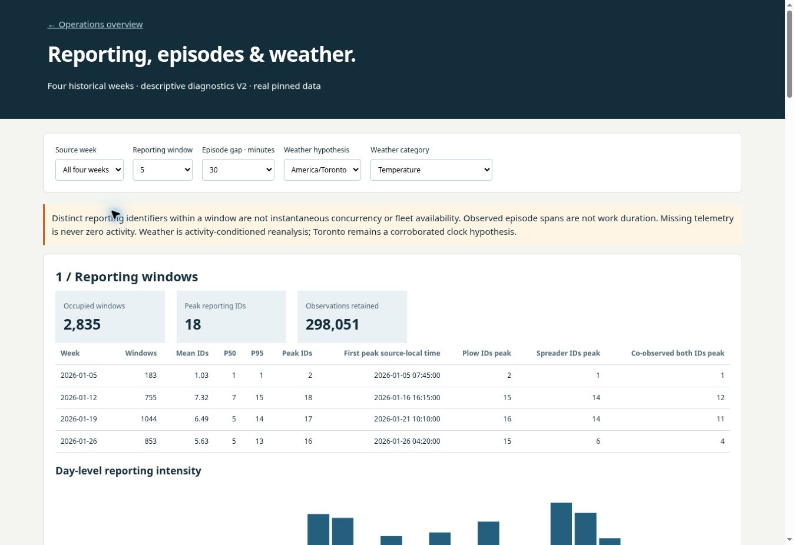
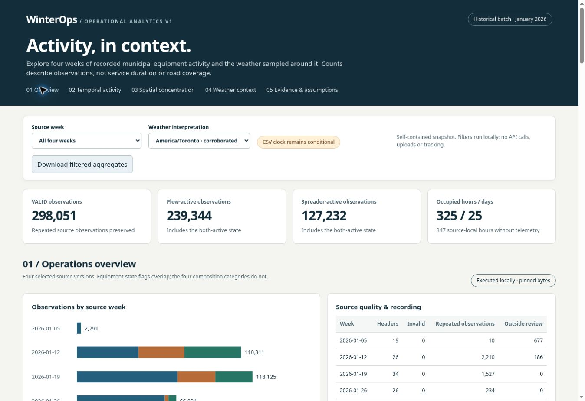
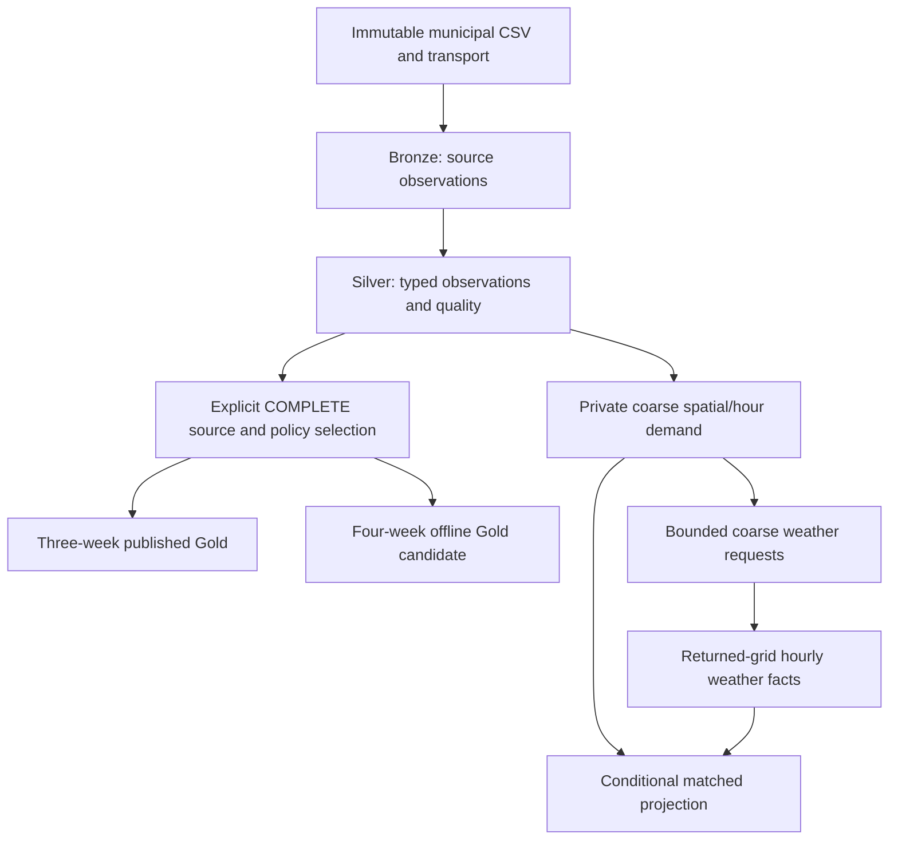

# WinterOps | Weather-Driven Municipal Operations Intelligence

**Current extension — November 5, 2026:** [Unified geographical application](dashboard/geospatial.html) with real official roads, public/local-file modes, actual movement/episode playback and cached weather. Seven local source weeks reconcile to **338,746 VALID observations** (+40,695). Start with the [V3 findings](docs/GEOSPATIAL_V3_FINDINGS.md), [source inspection](docs/GEOSPATIAL_V3_SOURCE_REVIEW.md) and [Windows/offline replay guide](docs/GEOSPATIAL_V3.md). **366 tests pass.** The original four-week native evidence is unchanged; zero Databricks or weather API calls. V1/V2 below are retained historical milestones.

[](https://github.com/cevateness/winterops-databricks-lab/actions/workflows/ci.yml)

**Operational diagnostics V2:** open [dashboard/diagnostics.html](dashboard/diagnostics.html) for actual reporting-window distributions, episode-gap sensitivity, equipment transitions and weather relationships. [Nine computed findings](docs/OPERATIONAL_DIAGNOSTICS_V2_FINDINGS.md) · [definitions, private map and Windows reproduction](docs/OPERATIONAL_DIAGNOSTICS_V2.md). Peak reporting is 17 IDs/minute or 18 IDs per 5/15-minute window; 30-minute segmentation yields 1,202 observed episodes. These are reporting/observation diagnostics, not fleet availability or work duration. **345 tests pass.** Continues PR #19 and its dependency on PR #18.



**Current status — November 4, 2026:** PR #17 is merged. Four historical source weeks have passed native Bronze/Silver ingestion. Three-week Gold is historically published and verified. The four-week Gold candidate is implemented and offline validated; native publication is conditionally authorized but blocked here by unavailable pinned private artifacts and secure Databricks access. No Databricks request or mutation occurred in the current assignment.

**Phase 2 now has a working analytical product:** open [dashboard/index.html](dashboard/index.html) from your local checkout. Explore four actual source weeks, equipment composition, daily/hourly recording patterns and missingness, privacy-safe coarse concentration, cached weather and Toronto/UTC sensitivity. It runs entirely in the browser with no API calls. [Product guide, contracts and Windows reproduction](docs/OPERATIONAL_ANALYTICS_V1.md) · [actual execution](dashboard/execution.json) · [roadmap](docs/ROADMAP.md). **327 tests pass.** The implementation is on `feat/operational-analytics-v1`, stacked on still-open PR #18; neither PR is auto-merged.



The **activity-driven weather contract** derives coarse spatial/hour demand from private Silver, reports a coarse bounding box/convex hull, plans bounded requests and matches returned-grid weather facts. The four pinned public source files have been recovered and reconstructed locally, and the real plan retains all 298,051 VALID observations. **Approved spatial weather collection and local matching pass:** 24 successful requests, 2,088 hourly location records, nine returned grids and 1,684 conditional matched rows with complete current/antecedent coverage. This is local reconstruction/public-weather execution, not native Databricks integration. The retained 720-hour fixed-point sample/daily example is only an API/provenance and temporal fixture.

The [source clock and analytical review in PR #18](docs/TEMPORAL_ALIGNMENT_REVIEW.md) corroborates Toronto for the pinned January weeks: official Eastern/DST field metadata, 325 exactly matching hourly counts and eight agreeing timestamp-only endpoint samples. The historical CSV exporter clock remains undocumented, so original NTZ fields and both conditional retrospective hypotheses remain. The new dashboard reuses this evidence and the completed cached weather collection.

Start with the [spatial weather review revision](docs/WEATHER_ACTIVITY_REVISION.md), [development review](docs/DEVELOPMENT_REVIEW_2026_11_03.md), [normal batch runbook](docs/BATCH_OPERATIONS_RUNBOOK.md), [weather contract and reproduction](docs/WEATHER_INTEGRATION.md), and [current handoff](docs/STATUS_HANDOFF.md). Historical native evidence is retained for [incremental ingestion](docs/INCREMENTAL_INGESTION_FILES_ABSENCE_RESULTS.json), [three-week publication](docs/THREE_WEEK_NATIVE_INTEGRATION.md), and [four-week offline preparation](docs/FOUR_WEEK_GOLD.md). Earlier lesson reports describe their own snapshots, not current blockers.

**Purpose:** A personal Databricks learning MVP for reproducible data engineering and decision analytics. Research extensions and possible future commercialization remain separate scopes.

## Architecture today



Municipal processing uses the existing on-demand SQL-file Job and scoped manifest checkpoints. The weather path is portable local Python batch processing; no native weather tables exist from this task. The synthetic demand demonstration is separate from the actual collection/match evidence recorded above. The old fixed-point temporal fixture reads five existing public daily aggregates and cannot supply activity locations. Synthetic notebooks 01/02 and legacy single-week notebooks remain learning artifacts; notebook entrypoint execution is distinct from verified SQL/Jobs execution. No streaming, forecasting, SLA measurement or optimization is included.

## Historical single-week lesson observations (not current four-week scope)

| Metric | Reported result |
|---|---:|
| Source file | `snowplow-2026-01-12_2026-01-18.csv` |
| Bronze rows | 110,337 |
| Silver rows | 110,337 |
| `HEADER` (repeated in-body CSV headers) | 26 |
| `VALID` under current limited checks | 110,311 |
| Other `INVALID` | 0 |
| Distinct truck IDs in valid rows | 251 |
| Plow-active valid observations | 79,471 |
| Spreader-active valid observations | 68,870 |

`VALID` is limited to parsing, basic coordinate-world bounds, ID, time and Boolean checks; it does **not** imply correct road location, completion, or actual vehicle deployment. Source timestamps are stored as `TIMESTAMP_NTZ`: the timezone has **not** been established. This table describes the original single-week lesson. Later V2 source/quality/multiplicity evidence is recorded in the current handoff. The legacy single-week notebook rewrites its own table and is not the incremental V2 workflow.

## Layout

- `PROJECT_REFERENCE.md` — project charter, with current status appended.
- `AGENTS.md` — instructions for Codex and code reviewers.
- `docs/STATUS_HANDOFF.md` — latest verified versus pending work, known pitfalls.
- `docs/CODEX_CLOUD_TASK.md` — ready-to-paste Codex Cloud task.
- `docs/WINDOWS_SETUP.md` — fixes for missing `winget`, CLI authentication checks, Windows setup.
- `docs/GITHUB_CODEX_WORKFLOW.md` — public GitHub and Codex Cloud connection workflow.
- `docs/ANALYTICS_SLICE.md` — source/version contract, view definitions and integration acceptance gate.
- `scripts/install_databricks_cli.ps1` — optional portable official CLI installer, no WinGet/Admin required.
- `scripts/test_databricks_connection.ps1` — read-only connectivity and permissions diagnostics.
- `scripts/publish_to_github.ps1` — first push into a **user-created empty** public GitHub repository.
- `src/winterops/quality.py` and `scripts/validate_quality_snapshot.py` — dependency-free validation of aggregate QA evidence.
- `src/winterops/analytics.py` and packaged `src/winterops/sql/` — shared bounded SQL plan and offline reference counts.
- `scripts/render_analytics_sql.py` — offline renderer requiring a reviewed file SHA-256 and expected summary; `--validation-only` emits queries without view DDL.
- `src/winterops/gold_products.py` and `scripts/render_gold_products.py` — SELECT-only analytical products, independent Python reference calculations and offline dashboard SQL rendering.
- `sources.py`, `foundation.py`, `ingestion.py`, `spark_ingestion.py` and `scripts/windsor_history.py` — V2 discovery/staging, version/policy manifest, local incremental processing, aggregate diagnostics and isolated native plans. Record-bearing files are rejected under Git roots.
- `scripts/check_databricks.py` — named-profile/host-gated read-only CLI probe with sanitized output.
- `data/fixtures/windsor_week_2026_01_12_18_summary.json` — **aggregate results only**, no source telemetry.
- `.github/workflows/ci.yml` — offline tests on public GitHub, no Databricks secrets.
- `notebooks/01..05` and `sql/` — existing learning work, preserved.

## Work locally and sync

The existing local project folder is connected to GitHub. Continue working in that folder; use the [Git sync workflow](docs/GITHUB_CODEX_WORKFLOW.md#everyday-sync) to pull changes and push reviewed commits. Git sync happens when you run these commands; saving a file does not upload it automatically.

For a new computer or checkout:

```powershell
git clone https://github.com/cevateness/winterops-databricks-lab.git
cd winterops-databricks-lab
python -m pip install -e .
python -m unittest discover -s tests -v
```

The task in `docs/CODEX_CLOUD_TASK.md` can be implemented locally; Cloud selection is deferred. For optional Databricks CLI access, use `docs/WINDOWS_SETUP.md`. A live workspace target, reviewed source hash and user approval are required before applying the new views; see `docs/ANALYTICS_SLICE.md`.

## Run offline checks

Python 3.10+; no Spark installation required for basic tests:

```bash
python -m pip install -e .
python -m unittest discover -s tests -v
python scripts/validate_quality_snapshot.py data/fixtures/windsor_week_2026_01_12_18_summary.json
```

The aggregate fixture verifies **reported** invariants; it does not query Databricks or replace integration tests.

The expanded suite has 289 tests: existing analytics/contracts plus synthetic V2 revisions, policy changes, reruns, multiple weeks, interruptions, corruption/repair, source-quality edge cases, lossless gzip transport and SQL/Python reconciliation. SQLite tests adapt dialect/type details; they do **not** verify native V2 Spark/Delta writes or privileges. Notebook 06 defaults to `mode=render`; its apply path requires explicit approval and must not be used to replace the existing published views by default. The product and V2 plan renderers never execute SQL or create objects.

## Data handling, attribution and source claims

Raw operational CSVs, downloaded telemetry, Delta/Parquet files, database credentials, workspace profiles, API tokens, and personal files must **not** be committed. Use the synthetic demo fixture and aggregate reporting samples for the public repository. The original municipal files remain outside Git. The separately attributed public weather sample in `data/weather/` is an explicit exception; see its README and source contract.

When using public City of Windsor information, provide attribution:

> Contains information licensed under the Open Government Licence – The Corporation of the City of Windsor.

Licence: https://opendata.citywindsor.ca/Documents/OpenDataTermsofUse.pdf . The city does not endorse this project. Code licensing is **not yet selected**; public visibility does not by itself grant code reuse rights. Choose and add an explicit license before an intended open-source release.

Databricks Free Edition is for personal/non-commercial development and has quotas, security, and reliability limitations. Any future commercial system will require separate data-use, platform, and customer validation.

## Project boundaries

- No connection/migration from Sports-Market-Edge or industrial ETA Estimator.
- No claimed GPS coverage, working hours, response SLAs, workforce availability or savings inferred directly from counts of records.
- No assumption that a vehicle ID identifies a dedicated snowplow.
- No deletion of source observations in Bronze; quarantine questionable Silver records.
- No forecast leakage: historic **actual** weather must not be substituted for forecast data that existed at decision time.

Read `AGENTS.md`, `docs/STATUS_HANDOFF.md`, and the project charter before making changes.
