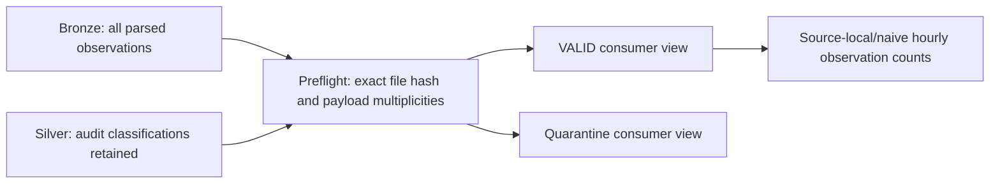

# Exact-version Silver consumers and hourly observations

Prepared locally on 2026-10-25. **Shared Lesson 6 SQL passed read-only validation; all three views were subsequently created and verified in separately approved Lesson 7 publication on 2026-10-28. The notebook/Spark entrypoint was not executed.** Lessons 1–5 and their source-table semantics are preserved. Publication evidence comes from actual SQL API results, not the existence of committed code.

Reviewed on 2026-10-28: the existing 46 tests passed before changes; the expanded suite passes 57 tests. The exact source version, required Silver schema and aggregate evidence are verified. After explicit approval, the schema recheck, both unchanged preflight statements and candidate Silver/Gold CTE statement succeeded sequentially with the bounded no-retry SQL API transport. All nine assertion outputs passed; see [SOURCE_VERSION_EVIDENCE.md](SOURCE_VERSION_EVIDENCE.md). Publication remains a separate approval.

Lesson 7 Phase A reconfirmed the source and existing creation rights. After separate publication approval, CREATE VIEW only created the three exact targets using the validated SELECT bodies. Metadata, published postflight and repeated safe aggregate reads passed. Gold has 79 hourly buckets and the expected observation/status totals; see [LESSON_7_PUBLICATION.md](LESSON_7_PUBLICATION.md) and [safe results](LESSON_7_GOLD_RESULTS.json). No replacement or DDL rerun was performed.



## Contract and intended artifacts

| Object in `workspace.default` | Behavior |
|---|---|
| `winterops_bronze_windsor_activity` | Existing Delta source; read only |
| `winterops_silver_windsor_week_sample` | Existing one-week Delta source; read only |
| `winterops_silver_windsor_valid` | Published view: exact dataset, filename, Volume path, byte-level SHA-256, `VALID`, and half-open source-local/naive window |
| `winterops_silver_windsor_quarantine` | Published view: same version, all non-`VALID` classifications, including nulls for audit |
| `winterops_gold_windsor_hourly_observations` | Published view: hourly counts sourced only from the valid view |

The initial notebook targets `[2026-01-12 00:00:00, 2026-01-19 00:00:00)` in the **unverified source timezone**. It never labels that window UTC. The portable configuration permits a different explicitly approved window of at most seven days, with corresponding source metadata and expected evidence.

The source-audit inventory matched file SHA-256 **`f5d7633c910e1ad6be23b4111445bf0bc14fe2071c6ea0f0d4cd456295ea9e94`** in Bronze and Silver, with the exact dataset, filename and Volume path. The current 8,671,212-byte Volume CSV was independently checksummed in the warehouse and matched that hash; only hash/size were returned. The reported fixture counts were independently reconciled to this version through SQL. Keep the fixture's original provenance; use the separate live evidence record for this verification and recheck the source before validation/publication.

Preflight checks require:

- The existing Silver schema, including `event_time_unzoned: TIMESTAMP_NTZ` and actual Boolean status fields.
- Exact Bronze/Silver version counts and per-payload multiplicity equality, including repeated payload warning counts.
- No unrelated file/path/version in the single-week Silver snapshot; Bronze may retain other versions.
- Known quality classifications, consistent header/invalid issue fields, nonnull/valid fields and in-window times for `VALID` observations.
- Agreement with the explicitly supplied expected summary. The reported 110,337/26/110,311 counts are fixture-specific inputs, not global thresholds.

Headers and invalid rows stay in the original audit tables. Repeated valid payloads stay in the clean consumer and count as separate observations. Preflight rejects unknown/null classifications, while the quarantine definition keeps them visible if a later source change introduces them.

Gold exposes `observation_count`, `plow_active_observation_count`, `spreader_active_observation_count`, `distinct_truck_count`, and `repeated_payload_observation_count`. The last metric counts **all observations whose payload repeats**, not only excess copies. Truck counts are distinct within an hour and must not be summed into a weekly distinct count. Missing hours produce no rows; this does not establish inactivity or zero workload.

Hour truncation takes the first 13 characters of the `TIMESTAMP_NTZ` wall-clock string, appends `:00:00`, and casts back to `TIMESTAMP_NTZ`. It performs no timezone/instant conversion. Observation counts are not service minutes, hours worked, cleared kilometers, route coverage, SLA attainment, productivity, or verified deployment. `VALID` still means only the existing field checks passed.

## Render locally without Spark or credentials

Use the actual **reviewed file hash** in place of the placeholder:

```powershell
$sourceHash = '<64-lowercase-hex-characters-from-Bronze>'
python scripts/render_analytics_sql.py --source-file-sha256 $sourceHash --expected-summary data/fixtures/windsor_week_2026_01_12_18_summary.json
# Read-only SELECT plan for candidate consumers, with no view DDL:
python scripts/render_analytics_sql.py --source-file-sha256 $sourceHash --expected-summary data/fixtures/windsor_week_2026_01_12_18_summary.json --validation-only
```

This prints a deterministic plan. It executes no SQL, contacts no workspace, writes no output files, and never infers a hash from the aggregate fixture. The six SQL templates are packaged under `src/winterops/sql/`; the CLI and notebook share the same definitions.

The validation-only plan uses statement-scoped CTEs for candidate valid, quarantine and hourly consumers, derived from the exact same SELECT bodies used by publication. It checks source counts/multiplicities first, then candidate consumer/Gold reconciliation. It neither depends on existing consumer views nor creates temporary/persistent views. The notebook additionally checks the input schema before querying data; when reviewing SQL directly in an editor, inspect `DESCRIBE TABLE` and verify the documented Silver types first.

## Lesson 6 execution modes

| `mode` widget | Behavior |
|---|---|
| `render` (default) | Print the full SQL plan; no Spark queries or writes |
| `validate` | Read the Silver schema, run source preflight assertions, then reconcile candidate Silver/Gold results through CTEs; no DDL or source writes |
| `apply` | Run preflight, explicitly create/replace the three views, then run postflight; requires separate user approval |

`validate` still uses workspace compute and requires an approved target and reviewed file hash/evidence. It is not a claim that any live validation has been performed. The prior `apply_views` widget is ignored, including a saved `true` value. Select `mode=apply` explicitly only after approval; the Python `run_plan(..., apply=True)` API remains available for an approved caller. `validate_plan(spark, config)` exposes the read-only path.

The matching source inventory query, for a separately approved workspace session, is:

```sql
SELECT source_file_sha256, COUNT(*) AS bronze_observations
FROM workspace.default.winterops_bronze_windsor_activity
WHERE source_dataset = 'windsor_snowplow_activity'
  AND source_file_name = 'snowplow-2026-01-12_2026-01-18.csv'
  AND source_file_path = '/Volumes/workspace/default/winterops_raw/snowplow-2026-01-12_2026-01-18.csv'
GROUP BY source_file_sha256;
```

## Databricks acceptance gate

The shared SQL and controlled publication have now passed through the Statement Execution API. The following notebook workflow remains a separate, unexecuted runtime option. Do not rerun publication against the existing views by default; the package's apply path uses CREATE OR REPLACE and needs a new explicit replacement/grant review. Lesson 7 used create-only SQL instead.

1. Obtain explicit approval for the workspace, selected hash, expected evidence, bounded compute, and three view names. Pass the named-profile/host smoke test in `WINDOWS_SETUP.md`.
2. Open the repository in a Databricks Git folder with its `src/`, `data/fixtures/` and `notebooks/` directories available. The new notebook discovers that checkout; importing only the notebook is insufficient.
3. Open `notebooks/06_silver_consumers_hourly.py`, enter the file SHA-256, and keep `mode=render`. Review the generated SQL. This mode does not run Spark queries.
4. After approval of the read-only target/hash/compute scope, use `mode=validate`. It validates the schema and forces source and candidate-consumer assertions without creating any objects. Retain the actual result separately from offline evidence.
5. Only after separate approval for view writes, select `mode=apply`. It validates the schema, forces preflight, creates/replaces the three views in order, then forces postflight reconciliation.
6. Repeat read-only validation/postflight with the same source and configuration. Confirm definitions and aggregate counts are unchanged; retain only reviewed aggregate QA evidence. Repeated DDL requires its own approval and is not implied by stable reads. No Bronze/Silver write or scheduled job is part of this operation.

To test **before DDL**, an approved Spark session can call `validate_plan(spark, config)`. This checks the candidate Gold query as well as source preflight. Use `EXPLAIN` on SELECT bodies for additional runtime compatibility review. Offline Python/SQLite tests do not validate Spark SQL analysis, Unity Catalog privileges, or actual workspace data.

Views read the current source tables. They are not immutable Delta snapshots. If Lesson 5 later rewrites Silver to another hash, these scoped views may become empty; if the same hash is rewritten incorrectly, contents may change. Repeat preflight and postflight checks before using results. Keep writers stopped during publication: checks and the three view DDL statements are **not one transaction**. A failure can leave partial views; stop, inspect the actual state and obtain renewed approval for a scoped recovery. Do not rerun replacement DDL automatically. `CREATE OR REPLACE VIEW` can affect grants/ownership depending on runtime and view type; review grants before replacing shared views.

## Local evidence and remaining integration work

The offline suite covers synthetic repeated observations, half-open windows, timezone rejection, unknown classifications, schema policy, source/hash filtering, parameter injection, deterministic definitions, dry-run safety, preflight-before-DDL ordering and sanitized mocked CLI failures. SQLite-adapted SQL tests exercise reconciliation and view queries, including equal-total/different-payload failures and reruns. Additional tests validate candidate queries with no consumer views, preserve deliberately unrelated existing views, reject a wrong source version, and exercise notebook mode dispatch with fake widgets/Spark. These tests do not establish Databricks runtime behavior. Separate live evidence verifies source/schema/preflight, candidate SQL, actual create-only DDL, published postflight and stable repeated reads. Nested CTEs, NTZ predicates/hour construction and safe aggregate JSON all passed. No SQL compatibility error was observed; direct notebook/Spark execution, replacement and DDL rerun behavior remain untested.

No raw telemetry, real truck trajectories, tokens or workspace URLs belong in this public repo. Code licensing remains an owner decision; publication alone grants no code reuse license. The reported Windsor source attribution remains: “Contains information licensed under the Open Government Licence – The Corporation of the City of Windsor.” Source terms: https://opendata.citywindsor.ca/Documents/OpenDataTermsofUse.pdf. Redistribution/commercial rights beyond reviewed source terms have not been established here.

## Platform references reviewed on 2026-10-25

- [CREATE VIEW](https://docs.databricks.com/aws/en/sql/language-manual/sql-ref-syntax-ddl-create-view): query-backed views are virtual; creation/replacement changes view metadata and requires privileges.
- [TIMESTAMP_NTZ](https://docs.databricks.com/aws/en/sql/language-manual/data-types/timestamp-ntz-type): wall-clock fields without a timezone.
- [assert_true](https://docs.databricks.com/aws/en/sql/language-manual/functions/assert_true): raises an error when a check is not true.
- [Common table expressions](https://docs.databricks.com/aws/en/sql/language-manual/sql-ref-syntax-qry-select-cte) (reviewed 2026-10-28): query-scoped CTEs can contain nested CTE queries; candidate validation does not require persistent views.
- [CLI authentication](https://docs.databricks.com/aws/en/dev-tools/cli/reference/auth-commands), [workspace commands](https://docs.databricks.com/aws/en/dev-tools/cli/reference/workspace-commands), and [Jobs commands](https://docs.databricks.com/aws/en/dev-tools/cli/reference/jobs-commands): use current standalone CLI and named local profiles, not the deprecated pip `databricks-cli` package. Workspace API availability still requires a real smoke test. SDKs can use unified-auth profiles, but this slice adds no SDK dependency.
- [Free Edition limits](https://docs.databricks.com/aws/en/getting-started/free-edition-limitations): noncommercial use, serverless-only compute, restricted outbound networking, fair-use quotas, one 2X-Small SQL warehouse, and at most five concurrent job tasks. Account-level APIs are unavailable. None of these facts proves this user's workspace APIs are reachable.

This analytics slice adds no bundle, job submission or schedule. Connectivity, source audit, Lesson 6 validation and separately approved Lesson 7 publication/read verification pass. No notebook/Spark run was performed.
