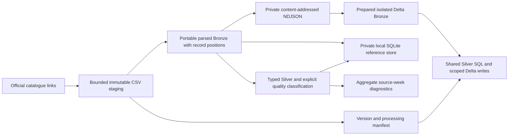

# Data Foundation V2 — multi-week Windsor history

**Implemented and tested locally; isolated native SQL-warehouse integration PASS.** This is one coherent implementation from merged main `929ffd6` (PR #5), on `feat/data-foundation-v2`. Existing one-week Bronze/Silver tables, published views, Lessons 1–7 and their evidence remain unchanged. The integration proposal is [DATA_FOUNDATION_V2_INTEGRATION.md](DATA_FOUNDATION_V2_INTEGRATION.md).

**Native follow-up:** After the initial large-upload deadline stop and separate explicit approval of gzip transport, the real artifacts, three development tables, scoped writes, two COMPLETE manifests, planned recovery and no-write reruns passed all 38 integration statements. The original one-week pipeline remains unchanged. See [actual evidence, timings and limitations](DATA_FOUNDATION_V2_NATIVE.md).

## Official source contract

The [City of Windsor activity catalogue](https://opendata.citywindsor.ca/details/224), reviewed 2026-10-29, describes a feed triggered when plow/wing or spreader activity is detected, with a nominal **15-second recording interval**. It describes weekly publication on Mondays during the winter collection season. This is a selected activity feed, not continuous all-vehicle telemetry or a fleet roster. True/false equipment flags describe the device's reported operating state at an observation. The legacy page now warns that it is no longer updated and links to a new portal's Snow Plow Routes layer; that route geometry must not silently replace these historical activity CSVs.

Included in the inspected CSVs: `Latitude`, `Longitude`, `Date time`, `Plow status`, `Spreader status`, `Engine status`, `Truck`. Despite the catalogue mentioning wings, these files have no separate wing-status column. Do not invent one or assume how wing activity maps to the plow flag. Operator identity, shift/eligibility roster, road service completion, distance, duration and availability are not supplied. Missing records, missing hours/days and long gaps do not establish inactivity. Multiplying record counts by 15 does not establish working time: reporting is activity-triggered and the files contain ties, repeats and irregular gaps.

The timestamp text has no offset. Its timezone, clock-change behavior, coordinate datum and identifier lifecycle are not confirmed by the reviewed description. Preserve `event_time_unzoned` as `TIMESTAMP_NTZ` / source-local/naive. A website scraper's timezone metadata is not evidence of the dataset timezone. Conventional latitude/longitude world ranges are field checks, not proof of CRS or geographic accuracy.

The [Windsor Open Government Licence v1.0](https://opendata.citywindsor.ca/Documents/OpenDataTermsofUse.pdf) permits reuse subject to attribution and its exclusions, including personal information and unlicensed third-party rights. It provides no endorsement or warranty. This implementation stages the two requested public files privately and publishes aggregate evidence only; it does not redistribute telemetry or claim that all information is unrestricted. Attribution:

> Contains information licensed under the Open Government Licence – The Corporation of the City of Windsor.

## Observed source differences

The two [official January 5–11](https://opendata.citywindsor.ca/Uploads/snowplow-2026-01-05_2026-01-11.csv) and [January 19–25](https://opendata.citywindsor.ca/Uploads/snowplow-2026-01-19_2026-01-25.csv) downloads returned HTTP 200 and `application/octet-stream`. Both parsed as UTF-8 CSV with the same seven columns/order, comma separator, quoted fields, `yyyy-MM-dd HH:mm:ss` timestamps and `True`/`False` status spellings. Neither had malformed widths or missing non-header values. MIME type alone was not treated as schema validation.

| Measure | Jan 5–11, local V2 | Jan 12–18, prior native evidence | Jan 19–25, local V2 |
|---|---:|---:|---:|
| Parsed Bronze / Silver rows | 2,810 / 2,810 | 110,337 / 110,337 | 118,159 / 118,159 |
| Internal headers | 19 | 26 | 34 |
| VALID observations | 2,791 | 110,311 | 118,125 |
| Other INVALID | 0 | 0 | 0 |
| Observed identifiers | 27 | 251 | 316 |
| Maximum identifiers within one hour | 2 | 20 | 18 |
| Hours containing telemetry | 42 | 79 | 115 |
| Plow-flag observations | 2,790 | 79,471 | 92,747 |
| Spreader-flag observations | 164 | 68,870 | 50,405 |
| Repeated valid-payload members | 10 | 2,210 | 1,527 |
| Excess valid-payload copies | 5 | 1,113 | 770 |
| Zero consecutive gaps | 23 | 3,793 | 2,569 |
| Gaps above 1,800 source-clock seconds | 16 | 95 | 134 |
| Outside V2 review envelope | 677 | Not evaluated with this policy | 0 |

The original middle week was **not downloaded or reprocessed** in this task; its figures retain the provenance of the [prior native evidence](GOLD_ANALYTICS_NATIVE_VALIDATION.md). All new local reports, fingerprints, observation date ranges and diagnostic partitions are in [DATA_FOUNDATION_V2_SOURCE_REPORT.json](DATA_FOUNDATION_V2_SOURCE_REPORT.json). The additional-week SHA-256 values are:

- January 5–11: `271c9339a42043f441b6c17e82dd309609db4b20e9953b9f368a95ec472d763d` (221,818 bytes).
- January 19–25: `b78d0fb82c8e3c5204ee79eea7a03417cd54bc935ead9b04577a30dc908c7c49` (9,302,196 bytes).

Both files report true engine flags throughout non-header rows. January 19–25 has no valid observations dated January 24; that absence does not establish inactivity. January 5–11 has 2,385 pairs exactly 15 seconds apart; January 19–25 has 75,693. Other positive gaps, ties and repeats remain present, so nominal cadence must not become a duration conversion.

### Identifier participation review

The existing 251-weekly versus maximum-20-hourly observation is a union-versus-within-hour comparison, not a fleet count contradiction. It also does not demonstrate that 251 physical vehicles exist. The new weeks show 27 versus 2, and 316 versus 18. Of those new identifiers, respectively 25/27 and 302/316 appear on only one date; only **one raw identifier string is shared between the two additional files**. Values are digit strings, but no values are published.

These patterns warrant confirming identifier persistence/reassignment/anonymization with the custodian. They do not establish which explanation is correct or allow vehicles to be linked by inferred identity. A roster, identifier contract, shift eligibility and cadence contract are still absent. Never sum hourly distinct counts, daily participation or overlapping gap-band identifier counts into actual fleet size/availability. No provider contact was sent by this task.

## Implementation and data flow



| Component | Responsibility |
|---|---|
| `sources.py` | Official-link discovery, weekly period validation, SHA-256, bounded no-redirect/no-retry staging and retrieval journal |
| `foundation.py` | Portable Bronze parsing, typed Silver reference, quality policy and aggregate-only reports |
| `ingestion.py` | Durable local SQLite version/run/attempt manifest, scoped persistence, content-based rerun checks and immutable exports |
| `spark_ingestion.py` + `sql/v2_silver.sql` | Shared configurable Silver SQL, isolated PySpark/Delta adapter, and equivalent SQL-warehouse plan rendering |
| `scripts/windsor_history.py` | Local discovery, staging, processing, reporting and offline native-plan rendering; no authentication or remote execution |

### Record and version grain

- **Source version:** dataset + logical filename + exact file-byte SHA-256. Filename dates define a Monday-through-Sunday half-open source-local/naive window. Immutable paths include the fingerprint. Repeated imports retain first staging provenance and append retrieval events. A changed file is a new version, never an overwrite or automatic promotion.
- **Bronze observation:** `(source_version_id, source_record_number)`. The ordinal counts parsed CSV records after the outer structural header. Every parsed observation is retained, including identical records, internal headers, blank records and malformed widths. `source_line_end` records the ending physical line, including quoted multiline records. It is not an invented physical start-line identity.
- **Payload hash:** SHA-256 of compact UTF-8 JSON with original header order and explicit nulls. It is not the file checksum or a unique observation key. `raw_values_json` additionally retains every cell, including trailing malformed cells; typed fields are never substituted into raw payloads. Do not assume payload-hash serialization is byte-identical to the legacy Spark serializer for every future encoding.
- **Silver processing version:** source version + `PIPELINE_VERSION` + quality-policy SHA-256 forms `processing_key`. Changed policy or transformation revision retains previous Silver results. A selected dataset must name exact source hashes and processing keys; multiple source revisions are ambiguous unless explicitly selected. There is no implicit latest/active revision.

The source URL, filename/path/hash, retrieval time, ingestion time, record hash, record ordinal, covered dates and parse issues remain traceable. Raw strings preserve identifier whitespace/case; `TRUCK_WHITESPACE` is a diagnostic. The original one-week Silver's trimming behavior is not rewritten. Import retrieval timestamps describe first import into this immutable staging area (`LOCAL_IMPORT` for the inspected files); the bootstrap downloads did not record exact HTTP request timestamps. New direct downloads record `OFFICIAL_HTTPS` provenance.

### Manifest and recovery

Local `manifest.sqlite` contains immutable `versions`, policy-specific `runs`, append-only `attempts`, and private Bronze/Silver reference rows. It records source URL, filename, period, raw hash/size/path, UTC first/last seen, policy/revision, row counts, latest status, last successful stage and sanitized error codes. States progress through PROCESSING → BRONZE_WRITTEN → SILVER_WRITTEN → COMPLETE; failures record FAILED and retain the last committed stage. Staging has a separate retrieval journal, including bounded failures.

An unchanged COMPLETE version skips only after re-parsing the immutable bytes and comparing the complete ordered persisted rows, not just row counts. Another week appends another scope. A revised source or policy gets another key. After a committed stage with a lagging manifest, a later explicit invocation compares existing contents and resumes without duplicating observations. An incomplete attempt is retained as interrupted. No automatic retry loop runs.

Same-count corruption causes a visible failure. `--repair` is an explicit **local** repair of the exact selected version/processing key after raw-byte verification; other keys remain unchanged. Bump `PIPELINE_VERSION` for business-logic changes rather than using repair to redefine an existing processing key. There is no global truncate/overwrite, automatic active-version switch or source deletion. A local exclusive writer lock prevents overlapping attempts; a hard process crash may leave it behind. Inspect the private manifest/process and remove only the known stale lock after confirming no writer remains. Do not blindly expire locks or start concurrent writers.

The Delta adapter follows the same state model, with exact predicates and full `EXCEPT ALL` comparisons. It refuses writes unless all three exact development targets are explicitly approved. It verifies schemas, staged artifact bytes, scope and observation identity first. Each `replaceWhere` commit is atomic for one table; Bronze, Silver and manifest commits are **not** one transaction. A native hard interruption needs read-only state/content reconciliation before a later approved resume. SQL-warehouse plans provide equivalent predicates, shared Silver logic and aggregate postflight without requiring new compute. The SQL-warehouse route is now verified for these two versions; the optional PySpark adapter and unexpected-failure/concurrent behavior remain unexecuted.

### Quality policy and report semantics

| Check | Outcome |
|---|---|
| Recognizable internal header signature | HEADER / REPEATED_HEADER, retained |
| Missing/empty identifier; unparseable or zoned timestamp; timestamp outside declared week | INVALID with explicit issue(s), retained |
| Missing/nonfinite/out-of-world latitude or longitude | INVALID; neither NaN nor infinity is accepted |
| Unknown status spelling | INVALID; only ASCII-space-trimmed case-insensitive True/False is interpreted |
| Parsed CSV width mismatch / blank parsed record | INVALID and raw cells retained |
| Broken quoting, invalid UTF-8, duplicate/missing/extra outer columns, empty file or processing bound exceeded | Whole attempt fails observably; original immutable bytes retained, no partial version marked complete |
| World-valid coordinates outside review envelope | Warning only; field-valid rows remain VALID |
| Repeated payloads, timestamp ties, gaps, dense reporting, engine/equipment co-occurrence | Diagnostics, no automatic deletion or operational claim |

Default **review envelope**: latitude 42.1–42.5, longitude −83.3–−82.6. This deliberately broad configurable box is not an authoritative municipal/service-area geofence. The 677 warnings are geography review candidates, not 677 proven erroneous observations. Defaults of 15 nominal seconds, 1,800 long-gap seconds and 1,000 observations/identifier-hour are explicit sensitivity settings; only the nominal interval comes from the source description. The other thresholds are review choices, not observed capacity or SLAs. A changed policy produces a new processing key.

Weekly reports reconcile Bronze = Silver = HEADER + VALID + INVALID separately per exact version. Payload groups/members/excess, identifier participation, timestamp conflicts and consecutive-gap partitions use VALID rows; missing/status counts exclude headers and are labelled accordingly. Source-clock gaps sort times within each raw identifier, retain ties and omit artificial gaps before first/after last observations. Sorting cannot diagnose arrival reordering or clock rollback. No detailed identifiers, coordinates or trajectories are returned by the report API.

## Local use (PowerShell)

The default private root is `$env:LOCALAPPDATA\WinterOps\foundation_v2`. A root under any Git working tree is rejected. No raw downloads or record-bearing databases/artifacts belong in this repository, Git LFS, public CI or logs.

```powershell
python scripts/windsor_history.py discover
python scripts/windsor_history.py stage --url https://opendata.citywindsor.ca/Uploads/snowplow-2026-01-05_2026-01-11.csv
# Or adopt already-downloaded public bytes without another network request:
# python scripts/windsor_history.py stage --url <official-url> --file <private-csv-path>
python scripts/windsor_history.py process --filename snowplow-2026-01-05_2026-01-11.csv --sha256 271c9339a42043f441b6c17e82dd309609db4b20e9953b9f368a95ec472d763d --export-bronze
python scripts/windsor_history.py report
python scripts/windsor_history.py plan --filename snowplow-2026-01-05_2026-01-11.csv --sha256 271c9339a42043f441b6c17e82dd309609db4b20e9953b9f368a95ec472d763d
python -m unittest discover -s tests -v
```

`--policy <private-json>` accepts `QualityPolicy` fields. `plan` only renders SQL; it never authenticates or executes. Supplying both `--artifact-volume-path` and `--artifact-sha256` adds fingerprint/input guards, exact-scope Bronze/Silver DML and full-content postflight for a locally COMPLETE version. DDL is fail-if-exists CREATE, with no replacement. The subsequent integration plan controls execution; rendering is not approval.

Defaults cap source downloads at 64 MiB, use 60-second socket/in-stream checks, cap parse attempts at 500,000 observations and exported artifacts at 256 MiB. Local download checks are not a hard process deadline; the later native API scope requires one. Redirects/retries are disabled. The materializing local reference intentionally favors auditability at the inspected scale; it is not an unbounded ingestion service. January 19–25 took 47.650 seconds for local processing, excluding export, on this machine. The private SQLite store for both weeks is roughly 493 MiB, and NDJSON exports total approximately 149 MiB because audit metadata repeats per row. Disk/memory costs and full-row comparisons should be measured before increasing the bounds. Do not silently sample larger files.

## PySpark versus COPY INTO

| Concern | Selected V2 explicit parsing + scoped Delta approach | COPY INTO |
|---|---|---|
| Small historical batch | Standard-library parsing and a few explicit bounded files; shared SQL works with PySpark or an existing SQL warehouse | Convenient file-level incremental SQL loading |
| Duplicate observations | Explicit ordinal and full multiset comparisons retain every parsed record | Does not inherently deduplicate records within files; suitable parser settings are still required |
| Source modified at same path | Exact-byte fingerprint creates another immutable version | Already-loaded paths are skipped even when modified; force disables idempotency |
| Internal headers/malformed widths/multiline provenance | Canonical parser retains ordinals, physical ending lines and all raw cells; Silver classifies them | Direct CSV loading would still need tested header/corrupt-record policy and additional lineage work |
| Partial writes / reprocessing | Version/policy-specific replacement plus explicit manifest and recovery | File ingestion tracking is useful, but business-version selection, processing-policy revisions and multi-table recovery remain external concerns |
| Future alternative | No Auto Loader, streaming, scheduler or new compute required | Could load the same immutable NDJSON artifacts later, with manifest/provenance retained and no force reruns |

The existing Lesson 4 version-scoped Bronze pattern is useful; Lesson 5's full-table one-week refresh must not be used for an additional week. V2 keeps both untouched and moves reusable logic into modules. For these files, explicit parsing and scoped Delta persistence better expose version selection, record multiplicity and auditability. COPY INTO remains viable over immutable hash paths; it does not eliminate the need for this source-version/policy contract. Its modified-file and force behavior is documented in the [COPY INTO reference](https://docs.databricks.com/aws/en/sql/language-manual/delta-copy-into); [selective overwrite documentation](https://docs.databricks.com/aws/en/delta/selective-overwrite) describes predicate checks and per-table atomicity.

## Final engineering review and limits

- All **110 offline tests passed**, including the three added lossless-gzip transport tests. Coverage includes initial load, verified rerun, additional week, source revision, changed policy, interrupted stages, manifest lag, same-count corruption/explicit repair, drift, bad quoting, null/domain/status checks, multiline provenance, protected targets and SQL/Python differential classifications. Both parsers use ASCII numeric grammar and space trimming, rejecting underscores/Unicode numeric encodings and zoned/unsupported timestamps consistently. SQLite adapts native casts/functions; this is not native Spark/Delta evidence.
- Actual local processing and a verified rerun of January 5–11 passed; appending January 19–25 preserved all prior Bronze/Silver contents. Detailed records stayed outside Git. Only aggregate source reports are public.
- Record-bearing files are immutable and bounded. Local recovery is serialized; distributed/concurrent ingestion, automatic promotion, durable remote lease ownership and production scheduling are intentionally absent. The Delta adapter requires serialized invocation; its writes are not an exactly-once concurrent service.
- The original implementation was local only and its first native attempt stopped during upload. A separately approved gzip recovery now verifies plain/gzip real-file reading, Delta DDL/selective writes, full-content reconciliation, planned checkpoint recovery and no-write rerun decisions through the SQL warehouse. All 38 statements passed in 130.391 seconds; this is client wall time, not measured billing/CPU cost. The optional PySpark adapter, notebook and forced-crash recovery remain unexecuted. Existing Gold's one-week exact-version contract has not been broadened or pointed at V2. The uncompressed exporter remains the default; `--artifact-compression gzip` is an optional transport correction that preserves decoded records and uses a separate encoded fingerprint/path.
- Next steps: review this coherent implementation and completed native evidence, then address identifier/CRS/timezone semantics before broadening operational interpretation. Any V2 promotion or subsequent native write requires a separately reviewed scope. Weather, forecasting, optimization, dashboards, Auto Loader, streaming and scheduling are not part of this task.
