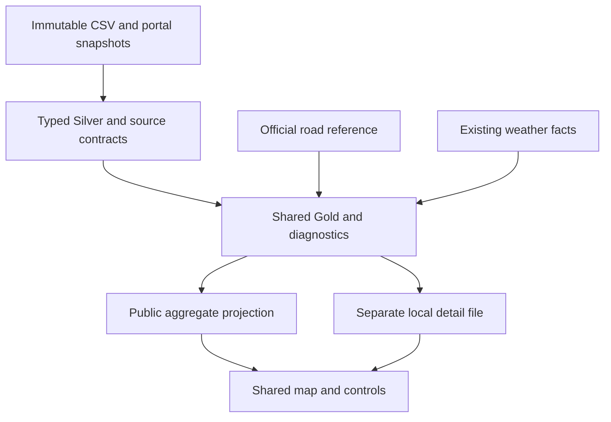

# Geospatial operations V3 — review and reproduction

V3 is a local historical product, stacked on PR #19, which is stacked on #18. The starting head was `e06f9b75ef93cca1cc6c02923c1ad1755c01d63b`; neither pending PR was merged or rewritten. [Findings](GEOSPATIAL_V3_FINDINGS.md) · [source inspection](GEOSPATIAL_V3_SOURCE_REVIEW.md) · [executed results](GEOSPATIAL_V3_RESULTS.json).

## What changed

Open **`dashboard/geospatial.html`**. One Leaflet component now serves the public aggregate view and the separately loaded local detail. It includes actual official streets, ward/city outlines, source selection, synchronized clock playback, equipment marks, observed episode inspection, weather centres and quality diagnostics. V1/V2 pages remain linked historical analyses; their old renderers are retained for historical replay, not developed as another current map. No authenticated public service or native dashboard was deployed.

The full local build actually processed seven exact CSV versions: **338,746 VALID observations**, 447 observed source hours, 39 observed days and 1,075 original coarse cell/hours. Three February weeks add 40,695 observations. The four-week baseline remains 298,051 / 239,344 plow-active / 127,232 spreader-active, with 325 hours / 25 days / four weeks. The native four-week selection, Gold expressions, ingestion and publication plan are unchanged. New February versions are **LOCAL_COMPLETE**, not native-ingested or native COMPLETE.

## Contracts and implementation

| Product | Key / grain | Important boundary |
| --- | --- | --- |
| Raw municipal version | Provider/dataset + filename + byte hash; parsed record ordinal | Preserve headers, repeats and original unzoned timestamps |
| Local Silver | Processing key + source record ordinal | Same existing quality policy; VALID does not certify GPS accuracy |
| Gold metrics | Existing UnifiedGold SQL at source/week, day, hour and cell/hour | No parallel JavaScript metric definitions; repeated records remain additive |
| Portal snapshot | Provider + city + layer URL + explicit query + schema/content fingerprints | OBJECTID identifies a row inside a snapshot, not a permanent event key; human scope aliases are not independent providers |
| Road candidate | Observation + immutable reference network + distance rule | Metres in EPSG:26917, traditional longitude/latitude order at EPSG:4326 boundaries; transform accuracy reported by PROJ is 4m, before GPS/reference uncertainty |
| Movement interval | Processing key + identifier + two unambiguous timestamp groups | Gap ≤60s, apparent speed ≤100km/h, displacement >3m, same state; neither snapping nor completed passage |
| Local display cell | Source + minute + 0.005° cell + equipment state | Count observations; distinct IDs within a cell are never summed into a city count |
| Reporting / episodes | Existing 1/5/15m buckets and 15/30/60m episode rules | Window reporting overlap, heuristic first observations, not capacity or work duration |
| Weather | Snapshot + returned grid + valid time, then existing source-hour summary | Toronto and UTC alternatives remain separate. Accumulations are never summed over locations |
| Requests | Bounded source snapshot; public city/day counts | Customer concerns, not verified unserviced roads, dispatches or completions |

`arcgis_source.py` handles count → ID list → exact bounded batches → repeat count/IDs/schema. Truncation, wrong IDs, missing fields, schema drift and incomplete pages fail. Raw HTTP bodies and failed attempts remain private; only a fully reconciled artifact gets COMPLETE. The connector retries at most once for HTTP 429/502/503/504, within its request budget. It does not retry arbitrary parsing failures or timeouts. No attribute-level transaction isolation is available: matching ID sets cannot exclude an in-place edit during extraction. Compare immutable snapshots rather than assuming the service is frozen.

`source_overlap.py` compares multisets, preserving repeated records. Converting the portal's integer identifier to text is explicit and preserves its original attribute. Six-decimal coordinate comparisons are separately labeled; the actual selected samples match without coordinate rounding. No overlap is appended.

`geospatial.py` prepares geometry and indexed distance candidates with pyproj/Shapely. The map uses a simplified **display-only** network; diagnostics use the full geometry. Matching distinguishes different COMPKEY road features, including intersections and parallel roads. Null portal street keys use snapshot-scoped OIDs, preventing all null-key roads collapsing into one candidate. Legacy LL84 COMPKEY uniqueness and WGS84 `.prj` are checked. Provider road-class codes remain codes; they are not silently converted into maintenance priorities.

Movement uses WGS84 geodesic displacement and explicit conditional clock conversion. Ambiguous/nonexistent Toronto DST times yield unknown intervals. January/February elapsed intervals are identical under Toronto/UTC; this does not formally verify the exporter clock. All rejected intervals have mutually exclusive reasons. Original points/ordinals remain in private source/Silver evidence; uncertain gaps are not drawn as continuous routes.

## Public versus local detail

The committed HTML/JSON contains fixed **0.25° source-week total cells ≥20 observations**, safe city-level products and official reference geometry. Public time/equipment controls are disabled for spatial data. Twelve observations are withheld from the public map and remain in all totals. There is no public private-data download or export endpoint.

The private replay package contains **`winterops-local-detail.json.gz`**. Choose it in the same page's file selector. Its exact byte count, SHA-256, scope identities, cell business keys and observation totals must pass before activation. Gzip reduces the transfer from 56.6MB JSON to 8.14MB. Decompression, filtering and rendering happen in memory. Unload clears the input and returns to public mode. No private content is in committed HTML, JavaScript or public JSON. A toggle is not authorization: the file is held separately by its owner. Content Security Policy blocks network data connections; all map assets are bundled, with no external tiles, analytics, browser storage or coordinate requests.

Local controls select source-local date, 1/5/15/60m buckets, bounded accumulation up to six hours, equipment state, speed, episode overlay and Toronto/UTC weather. Episode selection limits **fragment overlays**; cell/reporting metrics retain the full selected window. Reporting peaks and onset counts describe all states; the equipment filter selects activity marks/counts. A subhour weather overlay uses its containing historical hour, which may include weather later than the selected minute. This is retrospective context. First/last episode positions are observed endpoints, not actual route endpoints.

Public weather uses the existing deduplicated city/hour summaries, with unweighted means over recorded hours and both clock cases. Local weather shows returned centres, not invented grid boundaries. February weather is unavailable; no new Open-Meteo calls were made. Do not generalize the January weather findings to the expansion.

## Windows review

Use Python 3.11+ and Node.js for the browser-contract test. All private folders must be outside the checkout and every parent Git repository.

```powershell
git fetch origin
git switch feat/geospatial-operations-v3
python -m venv .venv
.\.venv\Scripts\Activate.ps1
python -m pip install -e '.[geo]'
python -m unittest discover -s tests -v
python scripts/render_geospatial.py --output dashboard/geospatial.html
python -m http.server 8000 --bind 127.0.0.1 --directory dashboard
```

Open `http://127.0.0.1:8000/geospatial.html`. Start in public mode, compare weeks and weather hypotheses, then select the private `.json.gz` file. Try January 16, 16:00 (4,333 observations; both-active filter 1,566), January 24 (missing telemetry), and a February source (weather unavailable). Test bucket size, next/previous, play/pause, accumulation and episode overlay; then unload. Do not place the private file under `dashboard/` or another served directory. The file picker needs a modern browser with Web Crypto and DecompressionStream; localhost is the tested route. The uncompressed 56.6MB cloud-browser transfer timed out; the compressed **full real-data** file loaded and passed browser QA. No synthetic detail was substituted.

For full offline reconstruction, extract the private replay ZIP into `C:\WinterOpsPrivate\v3-package`, then:

```powershell
python scripts/restore_geospatial_inputs.py --package C:\WinterOpsPrivate\v3-package --output C:\WinterOpsPrivate\v3-inputs
python scripts/build_geospatial.py --input-root C:\WinterOpsPrivate\v3-inputs --archive C:\WinterOpsPrivate\v3-inputs\weather.zip --output C:\WinterOpsPrivate\v3-build
python scripts/analyze_geospatial_findings.py --input-root C:\WinterOpsPrivate\v3-inputs --build C:\WinterOpsPrivate\v3-build --output C:\WinterOpsPrivate\v3-results.json
```

The restore helper re-adopts original CSV bytes to fix machine-specific paths without changing source identities. Actual restore/rebuild reproduced the private gzip file **byte-for-byte**, SHA-256 `4a3a1d76d7ba6e8d339b434dba359f24bf7831edf6a1e55596c8931926f91b45`. Output directories must be new. An interrupted private build can leave files but is not an accepted receipt; rerun into a new directory. Do not delete evidence or roll back source versions automatically.

`prepare_geospatial_inputs.py --output <new-private-folder>` is an opt-in public re-acquisition path, not run by CI. It is bounded by the recorded seven CSVs, one legacy road ZIP and eight query scopes. CSV revisions and ArcGIS schema/record-set changes are retained and rejected. ArcGIS re-acquisition compares explicit semantic fingerprints across envelope revisions; raw HTTP bytes and snapshot fingerprints remain separate. Use the private package for exact-byte replay. The tested original extraction and offline replay are evidence; the convenience re-acquisition script was not used to repeat all public downloads. `collect_arcgis.py` is the reusable single-layer entrypoint. Neither helper collects weather or contacts Databricks.

## Architecture and lessons



Business keys, grain and multiplicity are more important than adding validation endpoints. A source ordinal preserves records; a truck ID does not identify an event. A snapshot OID is useful for complete extraction but not cross-version deduplication. Reanalysis and GPS pings require a controlled many-to-one analytical join; otherwise repeated weather can be counted as independent evidence. A closed request would still require a trustworthy fulfillment definition before becoming an outcome label.

Leaflet was chosen over MapLibre's WebGL/style machinery for this modest offline vector product. No tile provider is needed; streets/boundaries remain available without tiles. The fallback for an unavailable map engine leaves analytical tables readable. Materialized spatial results are appropriate for expensive distance calculations; small portable batch transformations suit this MVP. SQL views remain suitable for existing Gold metrics, while presentation JavaScript selects already-defined measures. A future larger spatial join could move into a materialized spatial engine after actual performance warrants it.

Before prediction: confirm identifier lifecycle and clock/DST behavior, explain contradictory flags and stationary/off-reference periods with the custodian, obtain independent event/outcome definitions, and define weather exposure independently of recorded activity. For decision-time prediction, acquire issue/availability-stamped forecast histories and more independent seasons. No forecast, optimization, capacity, service-level or savings claim is supported here.
