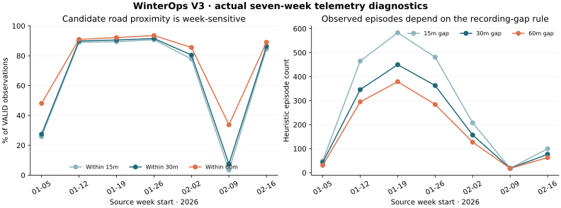

# V3 findings — actual historical evidence

All results below were computed from seven verified local CSV versions and bounded actual official snapshots. [Machine-readable supporting tables](GEOSPATIAL_V3_RESULTS.json) · [interactive product](../dashboard/geospatial.html) · [definitions and reproduction](GEOSPATIAL_V3.md). No forecast, significance, causal or service-performance inference is made.

## 1. The history expanded, but recording intensity did not expand uniformly

| Source week | VALID observations | Recorded hours / days | Peak distinct reporting IDs in 5m | 30m observed episodes | Created 311 reports |
| --- | ---: | ---: | ---: | ---: | ---: |
| January 5 | 2,791 | 42 / 7 | 2 | 43 | 11 |
| January 12 | 110,311 | 79 / 7 | 18 | 346 | 134 |
| January 19 | 118,125 | 115 / 6 | 17 | 450 | 292 |
| January 26 | 66,824 | 89 / 5 | 16 | 363 | 484 |
| February 2 | 20,568 | 77 / 6 | 17 | 157 | 151 |
| February 9 | 2,815 | 21 / 4 | 2 | 18 | 78 |
| February 16 | 17,312 | 24 / 4 | 15 | 77 | 6 |

**Unit/support:** source week; `weekly_metrics`, weekly `reporting`, `episodes`. New history adds **40,695 observations (13.65% of the original 298,051)**, 122 occupied hours and 14 observed days. Seven-week totals: **338,746 VALID**, 149 repeated headers, zero other INVALID; 447 / 1,176 possible source-clock hours contain telemetry. The other 729 hours are unknown activity. The highest 5m reporting peak remains 18; February peaks vary 17/2/15. These are occupied-window reporting IDs, not simultaneous fleet availability. Counts are clock-invariant for these winter weeks; capture/event selection prevents a service-demand trend claim.

## 2. The selected portal records are an alternate representation, not extra activity

**5,375 / 5,375** sampled records match exactly, including multiplicity, after the portal integer truck field is explicitly represented as text and its declared epoch dates are rendered in Toronto wall time. The samples are 2,791 (entire January 5 week), 1, 349 and 2,234 (first occupied hours of the other weeks). **Zero unmatched records** in those scopes; none were appended. Support: `overlap`. No rounding was needed; six-decimal comparison is separately recorded. The two feeds likely expose the same municipal system, so agreement is not independent sensor corroboration. This is not a record-level equality claim for all 298,051 January observations or the whole 502,312-record service.

## 3. A catalogue name and populated schema do not guarantee usable road attributes

The replacement road layer has **6,312 geometries**, but **6,312 null street keys, names and classifications** in the selected query. Its advertised `created_date` is omitted by the response. The older official ZIP has **6,304 polyline features** and usable COMPKEY, names and RD_CLASS. Support: `roads`, source register, real sanitized road-response fixture. It supplies the named/classified map and distance reference. The layer difference is not a construction-history measure. The older file was posted January 2025; neither reference is a certified January 2026 network snapshot.

## 4. Road proximity is common overall and strongly week-sensitive

| Week | Within 30m / VALID | Share | No road within 200m | Inside current city polygon |
| --- | ---: | ---: | ---: | ---: |
| January 5 | 766 / 2,791 | 27.45% | 1,410 | 1,434 |
| January 12 | 99,184 / 110,311 | 89.91% | 9,329 | 99,868 |
| January 19 | 106,963 / 118,125 | 90.55% | 7,906 | 109,330 |
| January 26 | 61,201 / 66,824 | 91.59% | 3,703 | 62,952 |
| February 2 | 16,555 / 20,568 | 80.49% | 2,449 | 18,046 |
| February 9 | 211 / 2,815 | 7.50% | 1,857 | 975 |
| February 16 | 14,935 / 17,312 | 86.27% | 1,830 | 15,259 |

**Unit:** retained observation, not independent service pass. Support: `sensors`, figure left, map quality panel. Overall **299,815 / 338,746 (88.51%)** are within 30m. Threshold sensitivity is **295,965 at 15m / 299,815 at 30m / 307,116 at 60m**. The low January 5/February 9 results survive threshold changes, although February 9 rises to 949 at 60m. **28,484** have no candidate within 200m; **30,882** lie outside the current city polygon. Regional observations and incomplete/reference-dated road coverage are alternative explanations to sensor error. A nearby line proves neither travel on that road nor plowing.

## 5. A nearest-road assignment often has material ambiguity

**69,592 / 299,815 (23.21%)** observations within 30m have a second distinct road candidate within 10m of the nearest distance. Support: `sensors.road_ambiguous_at_30m`, dashed private fragment overlays. This occurs at intersections/parallel geometry and uses full geometry in metre coordinates, not simplified display lines. Repeated pings weight this observation fraction; it is not 69,592 independent road visits. Changing the distance/tie rule changes membership. Deterministically choosing the nearest line would hide uncertainty.

## 6. Conservative movement reconstruction preserves uncertainty

There are **330,897 identifier/timestamp groups** in **995 source/identifier scopes**, yielding **329,902 consecutive intervals**. Of those, **235,012** meet the reference movement rule. Other mutually exclusive outcomes: **63,126 stationary**, **12,909 equipment-state changes**, **7,419 recording gaps**, **6,256 coordinate-tie-unknown**, **4,143 state-conflict-unknown**, **1,037 questionable speed**. Support: `movement`; private map fragment tooltips/episode overlay. Original records remain intact. Accepted straight fragments are observed displacement only; no road snapping, inferred missing route or distance-serviced total is produced.

The short, coordinate/state-unambiguous speed support is **312,084 intervals**: **13,969 exceed 60km/h; 1,037 exceed 100; 41 exceed 150**. These flags show threshold sensitivity, not certified speeding or equipment malfunction. January 5 has 388 of the >100 flags among only 2,666 supported intervals, warranting source/identifier review. Both clock hypotheses give the same elapsed intervals in these standard-time periods; DST edge behavior is separately tested and ambiguity is rejected.

## 7. Most contradictory flags concern the spreader flag

Seven weeks contain **4,147 contradictory state timestamp groups / 330,897 groups (1.25%)**; **4,092 / 4,147 (98.67%)** contain both-active and plow-only states. There are **3,257 coordinate-conflict timestamp groups**. Naively ordering repeated timestamps by source ordinal would create **4,148 zero-time state changes** (3,780 in the original four weeks). Support: `tied_state_review`, `movement`, preserved V2 transition tables. Those changes cannot establish real activation order; unknown endpoints stay unknown. **4,617 observations** belong to repeated-payload groups, distinct from **7,849 extra tied observations**. No records were removed. All engine flags are on; that internal consistency does not independently verify engine sensors.

## 8. Episode sensitivity remains substantial in the expansion

Across seven weeks, the 15/30/60m rules yield **1,904 / 1,454 / 1,197 observed episodes**; each alternative preserves 338,746 observations. The 15→60m reduction is **707 / 1,904 (37.13%)**, similar to V2's 37.3%. The new weeks contribute 326 / 252 / 208. February 9 stays at 18 under all thresholds, while other weeks change. Support: `episodes`, figure right. This is segmentation sensitivity, not evidence that 707 dispatches or work shifts disappeared. All actual starts/completions remain censored.

## 9. February 9 is an unusual recording sample, not a service score

All **2,815 / 2,815** observations are plow-only, with **2,684 / 2,799 (95.89%)** consecutive intervals classified stationary and only **93** accepted movement intervals. Only 975 observations are inside the current city polygon. Support: weekly metrics, `movement`, `sensors`. Contradictory state groups and repeated-payload observations are both zero that week, yet spatial/movement usefulness is limited. Passing duplicate/consistency checks is therefore insufficient to call sensors accurate. No precise outlier locations or vehicle histories are published.

## 10. Requests add independent reported concerns, not fulfillment labels

The bounded request source contains **1,156 reports**, with **175 on January 26 (15.14%)**. **35 reports on six days** have no recorded telemetry anywhere in that selected source-day. This includes 22 on February 12. Support: `requests.daily_counts`, daily Gold metrics. It establishes coexistence of reporting and telemetry gaps, not that those roads were unserviced. **277 / 1,156** lack a block; **1 / 1,156** lacks a ward; **all 1,156 lack geometry and mean coordinates**. No fulfillment/status field exists, so an address-level road join, exact activity/request lag or actual response-time KPI is unsupported. Do not impute missing activity as zero to manufacture one.

## 11. Weather evidence remains January-only; geographic context does not fix selection bias

The existing archive still reproduces **842 cell/hours and 298,051 observations independently per clock hypothesis**, with nine returned grids. The private map's January 16, 16:00 hour displays 4,333 observations, 1,566 both-active and 2,831 accepted fragments. Its four sampled temperatures are −3.10, −3.10, −2.50, −3.80°C under Toronto versus −5.20, −5.30, −4.80, −5.80°C under UTC (ordered by grid in the browser receipt). Support: UI evidence and unchanged weather matches. Public summaries reuse the existing deduplication; a rainfall mean is not a spatial precipitation sum. No February weather was downloaded, so persistence of V2 weather associations across the added events is **not established**. The additional geography and requests do not identify weather exposure hours, dispatch probability or causality.

## 12. Named corridor candidates recur across source weeks

Among observations within 30m of a named road **without the 10m competing-road ambiguity**, TECUMSEH RD E has **8,603 candidate observations across six weeks**, WYANDOTTE ST E **8,150 across five**, and DOUGALL AVE **7,635 across five**. TECUMSEH RD W has **4,874 across all seven**. Support: `pooled_corridors`; fixed all-seven-week projection, minimum 200 observations and four source weeks, with no day/hour or per-vehicle breakdown. The denominator is **230,223 unambiguous within-30m observations** before excluding unnamed references; repeated pings remain observations, not independent passages. These are nearest-reference candidates, not confirmed driven, assigned or cleared roads. Rank robustness under alternative distance/ambiguity thresholds was not established; the published 15/30/60m sensitivity covers overall proximity rather than corridor rankings.

## Evidence hierarchy and next step

Direct evidence is a reported record/time/coordinate/flag or a customer request. Derived evidence includes reporting overlap, episodes, movement fragments, proximity and conditional weather association. Independent official geometry corroborates geography; clock metadata corroborates interpretation; neither verifies actual service. Dispatch, assignment, work duration, clearing completion, salt quantity, capacity, SLA and savings remain unobserved. The next useful step is custodian clarification of identifier lifecycle/flag conflicts and independently defined event/outcome records, followed by representative exposure data—not a predictive model fitted to these pings.
