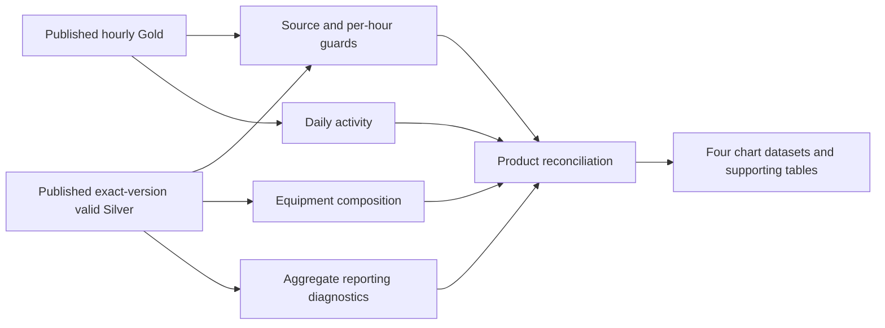

# One-week Gold analytical products

**Implemented and tested offline. New Databricks SQL runtime validation: NOT RUN; separate bounded read-only approval required.** Existing Lesson 7 published views and their evidence are unchanged. No new dataset was ingested and no remote object was created/replaced.

## Source and query contract

Inputs are the existing `workspace.default.winterops_silver_windsor_valid` and `workspace.default.winterops_gold_windsor_hourly_observations` views. The cohort remains:

- Dataset `windsor_snowplow_activity`; file `snowplow-2026-01-12_2026-01-18.csv`.
- Path `/Volumes/workspace/default/winterops_raw/snowplow-2026-01-12_2026-01-18.csv`.
- Source-file SHA-256 `f5d7633c910e1ad6be23b4111445bf0bc14fe2071c6ea0f0d4cd456295ea9e94`.
- Half-open source-local/naive window `[2026-01-12 00:00:00, 2026-01-19 00:00:00)`; the source timezone remains unverified.

`SourceScope` and `AnalyticsConfig` enforce bounded windows and safe source/catalog/schema parameters. Counts come from explicitly supplied, version-specific evidence, never universal thresholds. Valid Silver is filtered by all four source keys, VALID and the naive window. Gold has no path column: it is filtered by dataset/filename/hash/window and reconciled against path-scoped Silver per hour.

The two preflight SELECTs must pass before any product is consumed:

1. **Source/version/hour guard:** exact expected valid count, weekly distinct identifiers, status totals, field/repetition contracts, payload multiplicities, whole-view scope and a full per-hour Silver/Gold comparison. Equal weekly totals cannot hide an incorrect hour, hourly distinct count or duplicate Gold bucket.
2. **Product reconciliation:** the actual product query bodies are reused in CTEs. Daily/hourly equipment partitions, status totals, telemetry-hour totals, observation-frequency/participation histograms and `gap pairs = observations - observed identifiers` must reconcile.

`validate_product_schemas(valid_types, gold_types)` is a pure metadata gate for an approved caller. It requires the existing Silver types and NTZ/BIGINT Gold types. It performs no network request. Schema inspection and both preflights remain mandatory during native acceptance; a renderer cannot force a dashboard/operator to honor a failed guard.

The SQL builder/renderer imports no Spark, SDK or authentication client. It renders SELECT/WITH queries only. Stored source-hash binding relies on the existing validated objects; these products do not independently rehash the raw CSV. Views are not immutable Delta snapshots, so foundation checks must be repeated separately if sources change.

## Products and grains

| Query name | Grain and intended use |
|---|---|
| `daily_activity` | One observed source-local/naive day, derived from published hourly Gold |
| `equipment_hourly` | One observed source-local/naive hour, from valid Silver |
| `equipment_daily` | One observed source-local/naive day, from valid Silver |
| `fleet_overview` | One aggregate row over the complete selected cohort |
| `fleet_daily_participation` | One observed day; identifiers that reported at least once |
| `fleet_observation_frequency` | One populated weekly observation-count band; identifiers are mutually exclusive across bands |
| `fleet_gap_distribution` | One populated consecutive-gap band; pair counts are exclusive, identifiers can occur in multiple bands |
| `fleet_reporting_days` | One populated count of days with observations; identifiers are mutually exclusive across these bins |

Missing hours/days/bands produce no rows. Do not fill them as zero work, unavailable fleet or operational inactivity. All metrics cover VALID observations only, including retained repeated observations; headers/quarantined records are excluded.

### Daily activity

| Column | Meaning |
|---|---|
| `source_local_naive_day` | Source calendar date, with no timezone conversion |
| `observation_count` | Sum of hourly Gold observation counts |
| `plow_active_observations` | Observations whose plow flag is true; overlaps spreader counts |
| `spreader_active_observations` | Observations whose spreader flag is true; overlaps plow counts |
| `hours_containing_telemetry` | Number of distinct hourly buckets containing valid observations; not hours worked |
| `maximum_hourly_distinct_truck_identifiers` | Maximum observed identifier count in any one hour that day; never a sum of hourly distinct counts |

### Equipment-status composition

Both grains return `observation_count` plus these mutually exclusive counts:

| Category | Plow flag | Spreader flag |
|---|---|---|
| `plow_only_observations` | true | false |
| `spreader_only_observations` | false | true |
| `both_active_observations` | true | true |
| `neither_active_observations` | false | false |

The four counts sum to observations. Plow-only + both equals the plow total; spreader-only + both equals the spreader total. NULL status values fail preflight; non-Boolean status schemas must be rejected by `validate_product_schemas` before execution, rather than silently classified as neither.

`engine_off_observations` counts false engine flags. `engine_off_with_equipment_flag_observations` counts false engine flags with either equipment flag true, once per observation. It is a subset diagnostic, not an additional composition category. Status persistence, sampling and field semantics are not independently established: this co-occurrence does not prove mechanical inconsistency, bad data or actual equipment operation.

### Fleet reporting diagnostics

| Family/fields | Grain and interpretation |
|---|---|
| `observed_identifier_count` | Distinct raw identifier strings in the selected week; preserve whitespace/case, do not equate to registered fleet size |
| `observed_identifier_day_pairs` | Sum of each identifier's observed calendar days; not distinct fleet size or availability |
| Observation minimum/mean/maximum, frequency bands | Observations per identifier across the whole cohort; bands 1, 2–10, 11–100, 101–1000, 1001+ |
| Daily participation, reporting-days histogram | Identifiers reporting on each day, and number reporting on 1…7 days; no scheduled/eligible roster denominator |
| `singleton_identifier_count` | One observation for that identifier in the cohort; no consecutive pair exists |
| `constant_timestamp_identifier_count` | Multiple observations but only one timestamp; may include repeated payloads or changed payloads |
| Repeated payload groups / observations / excess | A group is one record hash with n > 1; observations count all n members; excess counts n−1. None are removed |
| `payload_identity_conflict_groups` | A hash associated with multiple identifiers or timestamps; lineage/reporting diagnostic, not proof of a hash collision |
| Same-timestamp conflict identifier/group counts | More than one record hash for an identifier at one timestamp. Changes may be legitimate; no coordinates are examined |
| `consecutive_timestamp_pairs`, `zero_gap_pairs` | Adjacent rows within each identifier after sorting by naive timestamp/hash. Repeated observations remain and create zero-gap pairs |
| Minimum positive / maximum source-clock gap | Extremes across observed consecutive pairs only; no artificial gap before first/after last observation |
| Long-gap pair/identifier counts | Gaps strictly greater than the configurable review threshold; not measured vehicle downtime |
| Dense identifier-hour/identifier counts, peak identifier-hour count | Counts strictly greater than the configurable observation-count review threshold, and highest observed count; not physical productivity |
| `whitespace_identifier_observations` | Raw strings with surrounding whitespace, counted without modifying/merging identifiers |

Defaults are **1,800 source-clock seconds** for gap review and **1,000 observations per identifier-hour** for dense reporting. They are sensitivity settings, not learned cadence, data-quality guarantees or operational limits. Record them with the cohort when comparing reports. An identifier may enter several gap bands; do not sum `identifiers_in_band` into a fleet count. Frequency/reporting-day bins do partition identifiers, so their identifier counts reconcile to the weekly observed count.

Gaps use an arbitrary calendar-field index from DATE differences, hour/minute substrings and decimal seconds, retaining microseconds. They do not cast to an instant, call Unix/UTC conversion functions or assume a timezone. Calendar-clock differences may differ from elapsed time across clock changes. LAG is applied inside each identifier over sorted source times: it cannot diagnose arrival reordering or clock rollback without an independent ordered observation sequence.

Observed identifiers are not fleet availability. IDs may be reformatted, reassigned or shared, and silent equipment may be available while reporting equipment may not be deployed. Availability requires an independently validated roster, eligibility/schedule, stable ID mapping and reporting-cadence contract. Those inputs are absent here. No working-time, distance, coverage, SLA or productivity metric is produced.

## Offline use and examples

```powershell
$sourceHash = 'f5d7633c910e1ad6be23b4111445bf0bc14fe2071c6ea0f0d4cd456295ea9e94'
python scripts/render_gold_products.py --source-file-sha256 $sourceHash --expected-summary data/fixtures/windsor_week_2026_01_12_18_summary.json --output .venv/gold-products-review.sql
python scripts/render_gold_products.py --source-file-sha256 $sourceHash --expected-summary data/fixtures/windsor_week_2026_01_12_18_summary.json --product equipment_hourly --long-gap-seconds 1800 --dense-hour-observations 1000
python -m unittest discover -s tests -v
```

The renderer includes both guards followed by all eight datasets, or the selected one. It only writes/prints UTF-8 SQL. It never executes it. For an approved Python caller, `build_products(config, DiagnosticSettings(...))` exposes `plan.preflight` and `plan.query(name)`. Run full-cohort gates once before loading datasets; keep the one-week cohort/thresholds fixed across all four charts rather than mixing a filtered daily chart with full-week diagnostics. Any display filtering should be clearly labelled and should not redefine fleet availability.

`data/fixtures/synthetic_gold_products.json` is wholly synthetic. Its 15 observations yield daily counts **9, 3, 3**, six hourly buckets, seven plow and five spreader observations. Equipment totals are **4 plow-only, 2 spreader-only, 3 both, 6 neither**; four engine-off observations include two with equipment flags. Six identifiers produce nine consecutive pairs, including four zero gaps and two above 1,800 source-clock seconds. These are test expectations, **not new Windsor findings**. No real rows or private identifiers were downloaded for this PR.

## Recommended four-chart dashboard

| Chart | Dataset/encoding | Decision supported and caveat |
|---|---|---|
| 1. Daily observation/status summary | `daily_activity`; grouped bars for all/plow/spreader counts; telemetry-hour and maximum-hourly-identifier counts in tooltips | Compare reporting volume across source dates. Do not stack overlapping plow/spreader counts or call telemetry hours work |
| 2. Equipment composition | `equipment_hourly` with optional switch to `equipment_daily`; four-category stacked bars, engine-off/equipment-flag diagnostic in tooltip | See observed flag composition and review inconsistencies. Counts are observation-weighted, not fleet percentages |
| 3. Identifier reporting participation | `fleet_daily_participation`; line/points for observed identifiers per source day; observation/hour counts in tooltips | Compare reporting participation. No availability percentage or fleet-capacity denominator |
| 4. Consecutive reporting-gap distribution | `fleet_gap_distribution`; bars for pair counts in zero/positive-within/above-threshold bands, identifiers/min/max in tooltips | Review ties and gaps under an explicit threshold. Identifiers overlap across bands; gaps are source-clock differences, not downtime |

Use source-local/naive axis labels and display the exact hash/window/settings. Keep raw IDs/record hashes out of charts, filters, exports and public drilldowns. The frequency/reporting-day histograms and overview are supporting aggregate tables for review, not additional required charts. Queries are dashboard-ready datasets; this PR does not create a dashboard or Databricks object.

## Validation evidence and native acceptance gate

- Initial canonical-main baseline: 57 existing tests passed; expanded suite: **80 tests passed**. New tests use independent Python expected metrics and SQLite-adapted execution of all query bodies/guards, including two identical reruns with no source/DDL changes.
- Tests cover exhaustive categories, hourly/day/Silver reconciliation, duplicate preservation, equal-weekly/wrong-hour Gold failures, wrong versions, inconsistent multiplicities, source type/window rejection, timestamp conflicts, microsecond midnight gaps, leap-day/negative-origin calendar indices, frequency/density boundaries and public output schemas.
- Python syntax, exact-hash offline rendering and isolated wheel smoke tests passed. The built wheel includes the new API and all ten SQL resources. Existing Bronze/Silver notebooks, published-view SQL definitions and real evidence were preserved.
- SQLite adapts catalog names, NTZ literals/date casts and decimal-second extraction; it does not verify Databricks parsing, native timestamp formatting/types, privileges, optimizer behavior or performance. The Python oracle is an offline reference, not a production extraction client.
- **No new query was executed in Databricks.** Existing Lesson 7 publication success does not certify these new functions/queries. Native compatibility remains NOT RUN pending separate approval.

Prepared future acceptance scope: the authenticated `winterops` workspace and previously verified existing warehouse; exact hash/window above; thresholds 1,800/1,000; one metadata schema query, both assertion queries, then eight aggregate products (**11 SELECT statements maximum**). Proposed bounds: 30-second wait with CANCEL on timeout, hard 45-second client deadline, **200 aggregate rows / 65,536 bytes per response** to accommodate at most 168 hours. No retries, DDL, source writes, jobs, permission or warehouse configuration changes. Stop on any error, mismatch, cancellation, unexpected shape or truncation. This scope is a proposal, not an approval or executed result.

Native review must specifically exercise NTZ-to-string/date formatting, DECIMAL second extraction, window ordering, the existing published schemas and the full-outer per-hour guard. It must retain source/version/settings and sanitized assertion statuses as new evidence rather than overwriting Lesson 7 provenance.

Official contracts reviewed: [DATE-only datediff](https://docs.databricks.com/aws/en/sql/language-manual/functions/datediff), [LAG](https://docs.databricks.com/aws/en/sql/language-manual/functions/lag), [timestampdiff](https://docs.databricks.com/aws/en/sql/language-manual/functions/timestampdiff). The timestampdiff TIMESTAMP/UTC contract is why this implementation uses explicit naive calendar fields instead.

## Short architecture review and subsequent work



The existing medallion foundation remains authoritative. A dependency-free Python builder renders shared SQL fragments; a separate Python calculation provides a synthetic oracle. Published Gold supplies daily activity, while Silver retains observation-level flags and identifiers internally for composition/window diagnostics. Final outputs are aggregate-only. No notebook is the sole home of logic, and there is no new persistent state or deployment framework.

Shared CTEs favor inspectability and source reuse at this one-week scale. They can rescan/sort Silver across datasets; only approved native execution can establish latency. If measured costs warrant caching/materialization, propose that separately with reconciliation and object-write approval. Do not add speculative infrastructure now.

Subsequent work, each separately scoped: validate observation cadence and an authoritative ID/roster mapping; inspect weather availability/licensing and temporal alignment; assess H3 only after spatial geometry/coverage definitions; design versioned multi-week ingestion and late-arrival rules; consider automated jobs only after repeatability/resource/auth reviews. Forecasting, optimization and commercial infrastructure remain separate later scopes.
