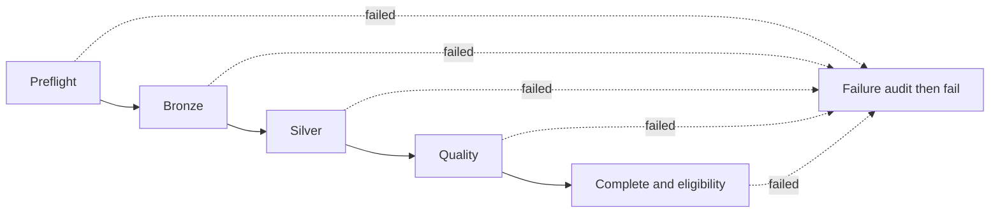

# On-demand batch orchestration V1

**LOCAL IMPLEMENTATION / OFFLINE PASS; NOT DEPLOYED OR RUN IN DATABRICKS.** Based on merged PR #9, main `7a3b8e6`. Prior three-week native evidence remains [published and verified](THREE_WEEK_NATIVE_INTEGRATION.md); it is not evidence that this Jobs workflow has executed. No workspace API, SQL, upload, job creation or remote modification occurred in this task.

This learning-MVP workflow processes **one explicitly selected source version and policy**. Acquisition, immutable CSV landing, local V2 parsing/export and artifact upload remain separate, reviewed steps. It does not fetch public sources, accept arbitrary paths, create tables, schedule ingestion, or modify Gold views. No new dependencies, audit tables, compute resources or streaming infrastructure are introduced.

## Architecture and reuse

`batch.py` validates requests, models a small SQL/conditional task graph and renders an immutable private Jobs package. `batch_sql.py` builds the graph from the existing `sql_version_plan`, `manifest_status_sql`, `OriginalLanding` and `UnifiedGold` contracts. `v2_silver.sql`, source-version construction, quality policy, pipeline revision and published view definitions are unchanged. The command-line entrypoint only prepares files; it has no Databricks client or deployment mode.



All five normal tasks use `ALL_SUCCESS`. The terminal failure task depends on all five and uses `AT_LEAST_ONE_FAILED`; it writes only a generic failure code for an attempt that passed preflight and actually began, then deliberately raises an error. A successful audit must not conceal the upstream failure. If canceled or unable to audit, Jobs run state plus the last persisted manifest checkpoint remain the recovery evidence. No raw exception text enters the manifest or public report.

The declarative [synthetic example](../jobs/on_demand_batch_v1.job.json) uses a fictitious warehouse ID and request: **never deploy it**. Generated real settings use the existing reviewed serverless SQL warehouse, six private Workspace SQL files, one concurrent run, disabled queue, zero task retries, no timeout retries, 90-second task timeouts and a 600-second job timeout. At most one task is active. One reusable job can later receive a separately reviewed settings/file update for another request; do not create a job per week.

SQL-file tasks on an existing serverless/pro warehouse are documented by [Databricks](https://docs.databricks.com/aws/en/jobs/tasks/sql). This avoids a new Spark job cluster or notebook dependency. Free Edition documents [one 2X-Small warehouse and five concurrent job tasks](https://docs.databricks.com/aws/en/getting-started/free-edition-limitations); a sequential graph stays within those published limits. Actual Jobs permissions, quotas and SQL-script compatibility in our workspace remain unverified.

## Request and parameter contracts

A private `BatchRequest` JSON contains the following. Reject unknown fields or malformed values rather than deriving an implicit latest version.

| Input | Meaning and validation |
|---|---|
| `version` | Existing `SourceVersion.to_dict()`: official weekly URL/filename/date contract, exact CSV hash, byte count, original acquisition path and UTC retrieval timestamp. Acquisition path is retained provenance, not rewritten to the Volume path. |
| `artifact_path`, `artifact_sha256`, `artifact_bytes` | Existing immutable `foundation_v2_dev/<version>/<transport-hash>/bronze.jsonl[.gz]`; exact path, encoded-byte hash and size. Transport differs from original CSV identity. |
| `expected_rows`, `header_rows`, `valid_rows`, `invalid_rows` | Reviewed counts for this exact source/policy; 1–500,000 total and HEADER + VALID + INVALID = total. These are not global Windsor thresholds. |
| `original_csv_path` | Existing `OriginalLanding` path, pinned to source filename/hash/size, including permitted legacy CSV reuse. |
| `policy`, `targets` | Existing `QualityPolicy` and three `DevelopmentTargets`; no arbitrary table names. Event timestamps remain `TIMESTAMP_NTZ`/source-local/naive. |
| `prior_attempts` | Exact observed manifest attempt count for an explicitly reviewed resume; default 0. New rendering is required to change it. This is not the Jobs run count. |
| `write_policy` | Default `complete_only` permits validation and skipping of an existing COMPLETE scope. `append_missing` prepares absent-scope processing/recovery for a separately approved run. It never permits conflicting-content replacement. |

The request digest includes the full request and pipeline contract; the review package also fingerprints every SQL file, request and Jobs settings file. The digest alone does not bind future code changes: approval must pin the commit **and** package file hashes. Real request/SQL/settings files include private provenance or warehouse identifiers and stay outside Git. Hex SQL literals preserve Unicode/backslashes; hex is escaping, not privacy protection.

Runtime Jobs parameters are `source_version_id`, `processing_key`, `request_sha256`, `execution_mode` (`verify`, default; or `process`) and `recovery` (`deny`, default; or `resume_matching`). Source/key/digest must exactly match the prepared request. They cannot retarget SQL to another source. `complete_only` cannot be changed into an append through a runtime parameter. For another source/policy or recovery attempt, prepare and review a new package/settings selection. Do not pass arbitrary extra/reserved runtime parameters; `batch_preflight_state` is populated by the task dependency, not the caller.

The code uses bound named SQL markers, not text interpolation of runtime parameters. Official [parameter access](https://docs.databricks.com/aws/en/jobs/parameter-use), [dynamic task result states](https://docs.databricks.com/aws/en/jobs/dynamic-value-references), [run-if dependencies](https://docs.databricks.com/aws/en/jobs/run-if) and [SQL scripting](https://docs.databricks.com/aws/en/sql/language-manual/sql-ref-scripting) support the proposed design. Named markers inside compound SQL-file tasks, conditional DML and actual output/failure behavior still require native validation. No stored procedure or SQL handler feature is required.

## Execution and recovery decisions

Preflight checks parameters, exact schemas for all three existing tables, original CSV and artifact bytes, staged row/ordinal/hash identity, full acquisition lineage, manifest metadata/policy and existing data content. Existing Bronze and Silver are compared in both directions using `EXCEPT ALL`, including audit columns and record ordinals. Repeated payloads remain distinct observations. A row count alone never authorizes skipping or replacing data.

| Observed state | Decision |
|---|---|
| Matching COMPLETE manifest, full matching Bronze/Silver, matching quality counts and Gold contracts | `SKIP_VERIFIED`; no data **or manifest** DML, even in `process` mode. Jobs tasks succeed while their write branches are skipped; this is not a Jobs `SKIPPED` run. |
| No selected manifest, no Silver; Bronze absent or fully identical (e.g. another policy already processed it) | `NEW_OR_REUSE_BRONZE`; verify mode reports readiness without writes. Approved `append_missing`/process may insert only absent layers. |
| Matching incomplete/FAILED attempt, or matching orphan Silver, with exact prior count | `RESUME_MATCHING`; inspect-only is allowed. Processing requires a newly reviewed package/attempt and explicit `resume_matching`. |
| Partial/conflicting contents, wrong lineage/policy/counts, duplicate manifest key, impossible checkpoint, stale attempt or corrupted COMPLETE | BLOCKED; no automatic overwrite, deletion, repair or version switch. |

Bronze begins attempt N+1 and records PROCESSING. It writes data only if that source scope is empty, verifies full content, then records BRONZE_WRITTEN. Silver rechecks the predecessor/attempt and data, writes only if its processing scope is empty, verifies full content and records SILVER_WRITTEN. Quality checks compare expected HEADER/VALID/INVALID counts, original/transport fingerprints and full Bronze/Silver reconciliation. The shared Gold gate runs against a SELECT-only projected COMPLETE manifest before completion. The final task repeats these checks, commits COMPLETE and checks actual COMPLETE eligibility. Eligibility means suitable for an **explicit** Gold selection, not automatic inclusion in the published three-week views.

Data DML reuses existing scoped `INSERT ... REPLACE WHERE` SQL, but its branch is reachable only when the selected layer is empty. Matching nonempty data is never rewritten. Manifest transitions reuse the existing scoped status helper. Bronze, Silver and manifest commits are **not atomic together**. A crash between a data commit and its marker can leave full matching data with an earlier marker; explicit recovery reconciles it and skips its data rewrite. Partial contents block recovery. COMPLETE corruption is not repaired by this workflow.

The manifest holds current state/counts/attempt number, not a complete historical ledger; private Jobs task/run history supplies orchestration history within platform retention. Generic `BATCH_TASK_FAILED` preserves the last successful stage. A failure before PROCESSING does not claim an unrelated existing attempt. A failure after committing COMPLETE leaves COMPLETE unchanged and the Job failed for inspection.

**Serialization premise:** `max_concurrent_runs=1` protects one Job only. It does not lock out SQL editors, notebooks or another Job. Require one active writer across all three target tables before processing/recovery; no distributed lock, cross-table transaction or exactly-once guarantee is claimed. Disable manual task retries/Jobs repair for V1: rerun the full workflow only after reconciling contents and preparing the explicit new attempt. Never auto-expire checkpoints or use `repair=True`.

## Local preparation and validation

```powershell
python scripts/prepare_batch_job.py `
    --request "$env:LOCALAPPDATA\WinterOps\batch_request.json" `
    --output-root "$env:LOCALAPPDATA\WinterOps\batch_v1\review" `
    --warehouse-id "<reviewed-existing-warehouse-id>" `
    --workspace-root /Workspace/Shared/winterops_on_demand_v1
python -m unittest discover -s tests -v
```

Build the private request from the already selected V2 source sidecar/local manifest, policy report and immutable export metadata; preserve their exact provenance. The renderer validates contracts but does not acquire bytes or attest remote state. Output is nine private files: six SQL files, `job.json`, `request.json` and `review.json`. All existing files must match before any missing file is written; differing files cause an immutable-package conflict. SQL uploads are capped at 256 KiB/file and 1 MiB total. Nothing is uploaded by this script, and the unrelated root `databricks.yml` is unused and unchanged.

**155 offline tests pass** (130 baseline + 25 orchestration tests; final full run 7.356 seconds, zero failures/errors), including a synthetic end-to-end task graph with real V2 Silver SQL, safe COMPLETE reruns, malformed selections/runtime parameters, lineage/schema/column-order/quality errors, duplicate manifests, partial content, failure propagation, committed-data interruption and explicit recovery. Other synthetic weeks and prior processing policies are compared before/after; matching recovery submits no Bronze/Silver DML. SQLite adapters replace file reads, Delta commits and native syntax; SQLite `EXCEPT` tests use unique record ordinals, while production keeps `EXCEPT ALL`. These do not establish native SQL scripting, Jobs permissions or scheduling behavior. Existing SQL differential tests independently cover transformations; no live success is inferred from them.

Syntax, aggregate-fixture and all SQL/Jobs renderer checks are required. GitHub CI adds the synthetic Jobs renderer and is assessed on the exact final PR commit. No credentials, vehicle identifiers, coordinates, payloads or source records are included in public evidence. The source-local/naive clock and unresolved timezone/CRS/identifier lifecycle caveats remain: observation counts/gaps do not establish fleet availability, inactivity, working hours, coverage or productivity.

## Engineering review and next gate

| Mechanism | What it establishes |
|---|---|
| Prior one-off Statement Execution integration | Native SQL/data compatibility for an exact manually reviewed matrix; actual prior three-week publication and preservation evidence. No persistent Job DAG or automatic orchestration. |
| This on-demand Job | A declarative dependency graph, bounded task runs, parameter guards, current manifest state, explicit recovery and failure propagation. Implemented/tested offline; deployment and native execution pending. |
| Scheduled ingestion | A recurring trigger plus source discovery/selection, acquisition approvals, concurrency policy, retention and monitoring. Not implemented or enabled by this PR. |

SQL tasks fit the warehouse route already used, reuse tested transformations and avoid new compute. Costs are repeated immutable-file scans and full comparisons; measure first on the small COMPLETE week. The prior combined three-week check canceled and the split hourly check had narrow timeout headroom. Jobs task timeouts are a separate mechanism from Statement Execution's wait/CANCEL and do not provide a 30-second limit per inner SQL statement. No billing or performance claim is made before native execution.

The concrete [first native deployment plan](ON_DEMAND_BATCH_DEPLOYMENT.md) uses the existing January 5–11 COMPLETE scope and `complete_only`: one Job, six SQL-file uploads, two bounded runs, **zero table/view DDL, zero table DML and zero record-bearing uploads**. New ingestion and native failure/recovery injection are deliberately outside that first scope and require a later exact approval. Weather, optimization, new Gold publication and automatic schedules remain subsequent work.
