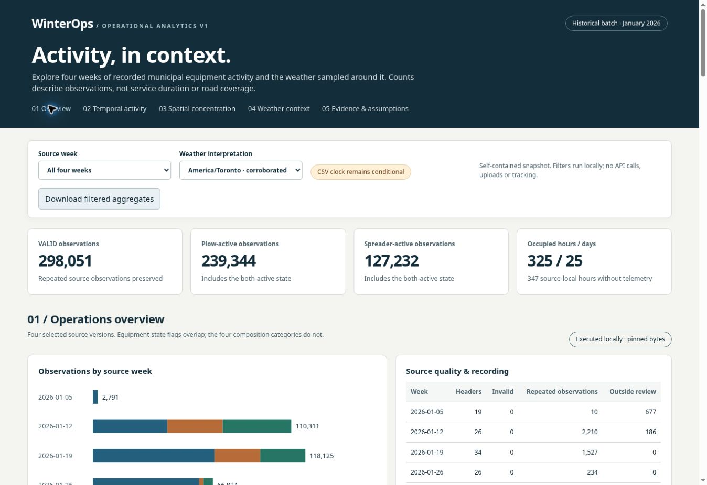
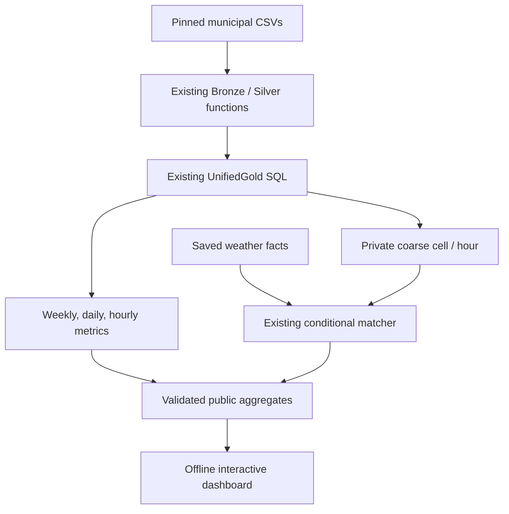

# Operational Gold Analytics & Weather Intelligence V1

**Phase 2 local analytical product implemented and executed, November 4, 2026.** Open `dashboard/index.html` in a browser. It includes actual aggregate data and all application code; there is no server, account, package download, API request or native deployment needed to explore it.

Development base: PR #18 head `bb7175f49d0d95d5f85739644dd85ad13d354c87`, because that PR was still open. This implementation is a stacked PR targeting `feat/source-time-evidence-and-analysis`; merge #18 first, then retarget this PR to updated main. No owner PR was auto-merged. Earlier work—four-week ingestion, UnifiedGold candidate logic, completed weather collection and temporal corroboration—is reused rather than reimplemented.



## Explore the product

1. Choose all weeks or one source week. Compare observation totals, equipment-state composition, source quality, occupied recording periods and coarse concentration.
2. Inspect daily bars and the source-hour calendar. Select a day from either graphic or the day selector. Grey hours/days mean **no VALID telemetry recorded, activity unknown**. They are never filled with zero service.
3. Inspect ranked or chronological hourly counts. Identifier counts are recomputed within their displayed grain; no cross-hour or cross-week sum is presented as fleet size.
4. Compare Toronto and UTC weather interpretations. Change temperature, precipitation, snowfall or the preceding two-hour weather measure. The day selector filters temporal details and weather; the week selector filters the whole dashboard. The spatial map remains a week-level public aggregate.
5. Download the filtered aggregate JSON with contracts, source lineage and weather provenance, or expand evidence details. Exports include all filtered hours, even when the table limits its initial display.

The dashboard is descriptive and retrospective. Toronto is the evidence-supported working interpretation; UTC remains a sensitivity case. Original NTZ fields are unchanged. This is not a forecast, road-coverage map, productivity score or fleet-capacity estimate.

Desktop browser QA actually exercised week/day filters, daily-bar selection, empty days, UTC sensitivity, antecedent measures and aggregate download. The exported January 15 selection contains one daily row, 24 hourly rows and 24 Toronto weather rows. Application console errors: none (unrelated browser-extension errors excluded). [Recorded UI checks](OPERATIONAL_UI_EVIDENCE.json). The cloud browser permits only HTTP/HTTPS and rejected direct `file://` testing; double-click launch is therefore not claimed as browser-verified here. If your local browser restricts file launches, serve it with `python -m http.server 8000 --directory dashboard` and open `http://localhost:8000/`.

## Architecture and contracts

| Product | Business key / grain | Meaning and lineage |
| --- | --- | --- |
| Bronze observation | Source version + parsed record ordinal | Original source record, including repeated payloads/headers. Raw files stay outside Git |
| Silver activity | Processing key + record ordinal | Typed classification under a pinned pipeline/policy; VALID is parsing/domain quality, not proof of service |
| Weekly Gold | Processing key | Full selected source week, equipment counts, recomputed distinct identifiers, observed recording periods and quality diagnostics |
| Daily Gold | Processing key + source-local naive day | Additive equipment/observation counts; distinct identifiers recomputed for that day |
| Hourly Gold | Processing key + source-local naive hour | Same counts at an hour bucket, with hour-specific distinct identifiers |
| Private cell/hour | Processing key + 0.25° cell + source-local naive hour | Same equipment metrics using `UnifiedGold.activity()`; every VALID coordinate is retained, with original review-envelope warnings |
| Weather fact | Weather snapshot + returned grid + UTC valid time | Cached temperature instant and preceding-hour precipitation/snowfall interval, with provider retrieval provenance |
| Private cell/weather | Cell/hour key + timezone hypothesis | Exactly one matched interpretation per cell/hour/hypothesis; each hypothesis preserves all source observations |
| Public cell/week | Processing key + coarse cell | Concentration for display; no cell/hour sequence or identifier count. Under-20 groups are withheld from the map, with an explicit accounting total |
| Public sampled weather/hour | Processing key + source-local hour + hypothesis | Unweighted mean/min/max over distinct returned grid/time samples, with present-sample denominators. No spatial precipitation sums |

Every public fact refers to a processing key in `scopes`, which carries the exact source name/hash/version, pipeline, quality policy and source interval. Shared contracts supply NTZ semantics, grain definitions and retrospective flags. Weather rows additionally carry the immutable weather snapshot ID; the bundle records the replay archive hash, model request attestation and attribution. Packed JSON stores each table as `columns` plus `rows`; `operational_dashboard.unpack()` restores named records without changing the content hash.



The local SQLite workspace is ephemeral and private. It runs the existing Gold product CTEs with narrow date/string/NTZ syntax adaptations; it does not duplicate metric expressions or manufacture native COMPLETE manifests. Its local gate means **all locally supplied pinned files were verified**, not that current native manifests or Delta versions were queried. Synthetic differential tests compare every Gold output column against the established independent row-based oracle and check the new cell SQL against the existing candidate CTE path. No frozen native-plan dependency was edited.

## What actually ran

The four municipal source files were recovered again because the prior raw cache was unavailable: **four official file downloads, 23,467,248 bytes**, exact existing hashes. The analytical builder itself is offline and does not download anything. It parses/types the original records with existing functions, then executes the Gold SQL locally. It reads the existing hash-pinned weather ZIP, reconstructs all matched rows with the existing matcher and executes the shared weather-summary SQL locally against those actual matches.

| Reconciliation | Actual result |
| --- | ---: |
| Parsed Bronze / Silver observations | 298,156 |
| VALID / HEADER / other INVALID | 298,051 / 105 / 0 |
| Plow-active / spreader-active observations | 239,344 / 127,232 |
| Plow-only / spreader-only / both-active / neither-active | 170,819 / 58,707 / 68,525 / 0 |
| Repeated-valid-payload observations retained | 3,981 |
| Weekly / daily / hourly Gold records | 4 / 25 / 325 |
| Private cell/hour records | 842 |
| Matched rows, Toronto and UTC separately | 842 each; 298,051 observations each |
| Executed shared weather SQL vs Python summaries | 650 source-hour/hypothesis rows, matching values |
| Source-local calendar / missing recording buckets | 672 / 347 |
| Outside-original-review observations retained | 863 |
| Map-displayed / map-withheld observations | 298,039 / 12 |

Exact execution receipt and artifact hashes: [dashboard/execution.json](../dashboard/execution.json). Independent checks match **every one of 325 recorded source-hour counts** and the full **50-row recorded daily weather review** from PR #18. Hierarchical reconciliation checks every additive equipment metric at cell→hour→day→week, so a correct grand total cannot hide redistributed activity. Join checks reject duplicate/missing keys, wrong source/policy, altered counts, mixed snapshots and conflicting weather facts.

The actual dataset contains no neither-active or engine-off VALID observations. This describes the captured records, not universal municipal equipment behavior. The source is activity-triggered, and recording volume varies sharply by week. Do not infer a demand trend or productive hours from that variation.

Verification: **327 tests passed**, including 20 new tests for full Gold-oracle parity, cell/hour hierarchy, multiplicity, nonadditive identifiers, missing telemetry, source scope, duplicate joins, mixed/conflicting weather snapshots, SQL/Python weather parity, public privacy, script-embedding safety and create-only replay. Syntax and all existing offline CI commands pass; the PR links the exact-commit CI result. These are local analytical and browser results, not native Spark validation.

The two largest coarse cells account for about 89% of observations; that is **recorded concentration**, with no road-network denominator. Nine coarse cells span a regional context beyond the original review envelope. No hull or box filters the analytical products. The public map suppresses cell/week groups under 20 observations, withholding 12 observations from display; complete private products and all city-level totals still retain them. Suppression is data minimization, not proof of anonymity. Raw positions, IDs and real cell/hour sequences are excluded from Git and HTML.

Weather facts are sampled where/when activity was recorded. Temperature is the instant at the source-hour start under the chosen clock hypothesis; the current accumulation describes `[hour start, hour end)`. The two-hour antecedent ends at hour start. Precipitation/snowfall means and ranges are per sampled grid/window, not municipal accumulation totals. Overlapping antecedent windows are never summed. The chart's source-clock spacing is calendar arithmetic for presentation; it does not assign UTC semantics to the source NTZ column.

**No new Open-Meteo requests, Databricks requests, DML, views, aliases, Jobs, schedules, permissions or compute changes occurred.** ERA5 identity remains request-parameter attestation, with source/retrieval metadata preserved in the existing archive. Native Spark/Databricks execution of these new analytical queries is not claimed.

## Reproduce on Windows

From the local checkout, fetch and switch to `feat/operational-analytics-v1`. The simplest review needs no Python:

```powershell
git fetch origin
git switch feat/operational-analytics-v1
Start-Process .\dashboard\index.html
```

Rebuild the interface from its committed **actual public aggregate snapshot** and run tests, without activating PowerShell scripts:

```powershell
py -m venv .venv
.\.venv\Scripts\python.exe -m pip install -e .
.\.venv\Scripts\python.exe -m unittest discover -s tests -v
.\.venv\Scripts\python.exe scripts/build_operational_dashboard.py --output-root "$env:TEMP\winterops-dashboard-review"
Start-Process "$env:TEMP\winterops-dashboard-review\index.html"
```

Outputs are create-only; use a fresh directory for another run. Public replay verifies the content hash and labels detailed spatial validation **NOT_RERUN_WITHOUT_PRIVATE_INPUTS** in its own receipt. It does not overwrite the recorded actual execution evidence or claim to have reconstructed raw sources again.

For a full local source/detail rebuild, retain the existing private `WinterOps_weather_integration_20261103.zip` outside every Git checkout. Use an existing `LocalStager` cache, or recover the four exact sources with the existing helper if absent:

```powershell
# Optional acquisition only if you do not already have the pinned source cache.
.\.venv\Scripts\python.exe scripts/reconstruct_weather_projection.py --private-root "$env:TEMP\winterops-pinned-source-cache"
# Offline build; no weather or native calls. All three rebuild arguments are required.
.\.venv\Scripts\python.exe scripts/build_operational_dashboard.py `
  --source-cache "$env:TEMP\winterops-pinned-source-cache\sources" `
  --archive "$env:TEMP\WinterOps_weather_integration_20261103.zip" `
  --private-output "$env:TEMP\winterops-analytics-private" `
  --output-root "$env:TEMP\winterops-dashboard-full"
```

The helper retains raw files and a private projection; the analytical builder uses its original CSV cache, not that reduced projection (which lacks equipment flags). The ZIP must match the existing execution receipt exactly. A changed or absent source/archive blocks the full rebuild, with no retries, alternate source versions or automatic overwrite. The committed dashboard remains usable without private artifacts. On Linux use `python` and normal paths; open the HTML directly or serve its directory locally.

## Databricks use and publication boundary

[Generated candidate SELECTs](../dashboard/databricks_candidates.sql) reuse `UnifiedGold.query()` for week/day/hour and the same `activity()` expressions for cell/hour. They read exactly the selected source/policy scopes and retain the existing candidate guards. They contain **no DDL or DML**. These are analysis queries for separately authorized execution, not a new native publication plan.

[Shared sampled-weather SQL](../dashboard/weather_hourly.sql) uses a distinct-grid/hour relation before averaging. It was executed locally on real cached matches and independently compared with Python. It needs the validated private `cell_weather` relation; **there is no native weather table or fabricated workspace binding**. A later approved native data-loading task is required before using it in Databricks.

The existing Gold publication plan is unchanged: reviewed SHA `1d22f9c99d2d540111296c890c3173ede71921665c5a1ac8cc938f64c589330e`, maxima 29 SQL submissions, 33 metadata GETs, 900 active seconds, and only the three exact create-only versioned views. Pinned private SQL/metadata/expected-results matrices and secure workspace bindings remain inaccessible. No native request was attempted and current Delta versions, permissions and target absence were not queried. The local reconstruction does not substitute for those approval inputs. Existing three-week Gold stays unchanged.

## Architecture trade-offs and learning

| Choice | Appropriate use | Cost / limit |
| --- | --- | --- |
| Databricks SQL view | Reusable definitions over selected Silver; transparent lineage | Recomputes underlying work and reflects source changes; three views are not one atomic publication |
| Materialized Gold table | Larger repeated dashboard workloads; a fixed refresh snapshot | Needs storage, refresh/idempotency policy and atomic publication/recovery design; unnecessary for 325 hourly rows now |
| Portable Python + local SQL | Bounded batch research, tests and reproducible artifacts without workspace access | SQLite dialect adaptation is logic evidence, not native type/optimizer/permission evidence; memory use is bounded to this MVP |
| Dashboard query / browser filter | Fast slicing of already validated aggregate facts | Must not introduce new definitions, add distinct counts, average incompatible grains or silently fill missingness |

Source contracts establish identity and quality; grain establishes what each row means. A processing key prevents accidentally combining reprocessed versions or policies. Weather facts and activity rows have different keys and multiplicities, so joining before deduplication can inflate both activity and precipitation. Alternative clock hypotheses are scenarios, not additive partitions. These lessons transfer directly to enterprise integration, financial facts, IoT telemetry and analytical marts.

We rejected a new dashboard server/framework, extra weather calls, historical ingestion reruns, native deployment certification, street-level maps, citywide precipitation sums and forecast/model work. A self-contained HTML artifact provides the requested exploration with little maintenance. CI uses the public snapshot and synthetic private-detail cases; ordinary ingestion receives **zero new API checks**.

Phase 2 is complete for the **bounded local descriptive MVP**. Native four-week publication and deployment remain separate blocked tasks. See [updated roadmap and Phase 3 prerequisites](ROADMAP.md). Before predicting, define the decision and target; obtain representative seasons/events and a defensible telemetry-missingness contract; confirm the export clock/DST behavior; preserve forecasts with issuance/availability times; and define chronological evaluation and simple baselines. Service-duration, coverage or capacity predictions additionally require corresponding independent labels/denominators. No forecasting model is implemented here.
