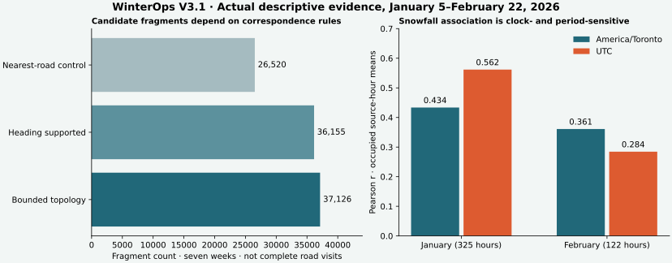

# V3.1 findings — executed November 6, 2026

Review [the shared map](../dashboard/geospatial.html), then [definitions and reproduction](ROAD_EVIDENCE_V31.md). All municipal findings use the same **338,746 VALID observations, January 5–February 22, 2026**. No municipal history was appended in this iteration. [Computed tables](ROAD_EVIDENCE_V31_RESULTS.json), [source comparison](ROAD_EVIDENCE_V31_SOURCE_REVIEW.json), [weather replay](ROAD_EVIDENCE_V31_EXPOSURE_REPLAY.json) and [execution](ROAD_EVIDENCE_V31_EXECUTION.json) distinguish actual execution from assumptions. No native Databricks calls occurred.

## 1. Proximity and supported movement measure different things

| Evidence / analytical unit | Actual count | Denominator |
| --- | ---: | ---: |
| Reported coordinate without a road within 30m | 38,931 | 338,746 source records |
| Nearby but ambiguous road candidate | 69,592 | 338,746 source records |
| Unambiguous proximity under the 10m alternative-separation rule | 230,223 | 338,746 source records |
| Records belonging to temporally/geometrically acceptable intervals | 267,634 | 338,746 source records |
| Records belonging to qualifying road sequences | **166,030 (49.01%)** | 338,746 source records |
| Sequence-supported intervals | **133,692 (40.52%)** | 329,902 consecutive timestamp-group intervals |
| Qualifying passage-candidate fragments | **37,126** | 329,902 candidate intervals examined |

Support: `point_evidence`, `observation_support`, reference `scenarios`. The first three rows partition records; later rows are overlapping evidence sets and must not be added. Each original record ordinal contributes at most once to a support count, including repeated source records. Tiers are rule-based evidence, **not calibrated confidence probabilities**. A sequence has at least three timestamp groups, stable equipment/compass quadrant, ≥20m projected progress and bounded road correspondence. Its mean length is only 3.60 accepted intervals: fragments are not whole road visits, unique trips, serviced kilometres or completion.

## 2. Corridor ranking changes with the unit of analysis

The previous proximity ranking put Tecumseh Road East first (8,603 selected point records), Wyandotte Street East second (8,150) and Dougall Avenue third (7,635). Reference movement-supported fragments instead rank **Dougall first (1,661 fragments / 5,004 supported intervals / five source weeks)** and **Tecumseh East second (1,411 / 4,685 / six weeks)**. E C Row westbound is third (1,341 fragments). These are fixed all-seven-week pooled counts; sparse road/time/state intersections remain private.

Support: `pooled_corridors`, `corridor_rankings`, previous `GEOSPATIAL_V3_RESULTS.json`; figure left. Dougall stays first across every heading/topology threshold scenario; Tecumseh varies between second and third. The nearest-road control puts them second and sixth. Ranking stability under a method does not validate the road reference or make these complete physical passages. Fragmentation at gaps, intersections, state changes and reversals affects counts.

## 3. Spatial assumptions matter more than widening short recording gaps

| One-at-a-time sensitivity | Candidate fragments | Sequence-supported intervals |
| --- | ---: | ---: |
| Reference: 30m / 30° / 60s / 10m separation / 100km/h | 37,126 | 133,692 |
| Road distance 15m / 60m | 34,207 / 39,615 | 124,021 / 141,471 |
| Heading tolerance 15° / 45° | 34,759 / 38,016 | 125,672 / 136,689 |
| Maximum gap 30s / 120s | 36,736 / 37,294 | 131,678 / 134,594 |
| Alternative separation 0m / 20m | 37,300 / 35,112 | 148,765 / 115,033 |
| Apparent-speed ceiling 60 / 150km/h | 35,238 / 37,145 | 123,927 / 134,023 |

Support: all seven source weeks, 329,902 intervals per experiment; `scenarios`. Distance and ambiguity thresholds materially change supported evidence. Fragment counts need not be monotone: accepting another interval can merge fragments. The topology reference supports 37,126 fragments versus 36,155 heading-only and 26,520 nearest-road controls. These are alternative correspondence algorithms, not nested accuracy certificates. **549 provider-node pairs fail the ≤5m endpoint check** and are excluded; topology is limited to two connected features, without legal-turn verification.

## 4. February 9 is concentrated stationary reporting, with unresolved identity semantics

The February 9–15 week contains **2,815 records in 16 source/identifier scopes**, all plow-only. **2,684 / 2,799 intervals (95.89%)** are stationary under the ≤3m rule. **1,840 / 2,815 records (65.36%) share one reported coordinate outside the current city polygon**, across six identifier scopes. Those six scopes' dominant-coordinate time spans have **zero overlaps among 15 scope pairs**. Six scopes contain only one coordinate; the longest stationary run has 962 timestamp groups.

The remaining 975 inside-city observations split into **211 within 30m of a reference road and 764 farther away**. Only **14 passage-candidate fragments / 46 source records** qualify under reference movement rules. Support: source diagnostic `february_case`, reference weekly scenarios; local quality overlay and **Fit selected activity**. The full 2,815-record portal sample matches the CSV exactly.

A fixed reported point and sequential identifier scopes are compatible with stationary equipment reporting, an export convention or identity rotation. They do not identify a depot, a physical vehicle, a GPS failure or a coordinate-reference error. Inside-city, off-network and ambiguous-road are separate diagnostics. Current city boundaries and January 2025 streets are imperfect historical references.

## 5. Contradictory states resemble timestamp-quantized updates, without proving that explanation

Of **4,147 conflicting identifier/timestamp groups / 330,897 groups**, **4,092 (98.67%)** contain both-active and plow-only. All 4,147 timestamps have whole-second precision. **2,236 (53.92%)** use exactly one coordinate; the other 1,911 have different coordinates but none exceed 30m separation (largest 26.07m). **3,661 (88.28%)** occupy consecutive source ordinals. **2,959 (71.35%)** have different, known equipment states immediately before and after, with both neighbours within 15 seconds.

Conflicts are distributed across 311 source/identifier scopes, with **2,059 in January 12 and 1,317 in January 19**. Source-ordinal two-record sequences include 1,942 both→plow-only and 1,923 plow-only→both. Those are **file ordering patterns**, never established physical transitions. Only **210 / 4,147** conflict groups contain repeated-payload records; exact duplication alone does not explain most conflicts. The new portal sample preserves all **72 sampled conflicting groups**.

Support: `source_diagnostics` and source comparison. Closely spaced updates sharing one-second precision are a plausible explanation; asynchronous equipment channels, source duplication and sensor inconsistency remain unresolved. Ordinals preserve evidence but do not establish within-second time. Conflicting endpoints remain unknown in transition and movement analyses.

## 6. Reported IDs cannot yet support physical-vehicle history

There are **995 source/identifier scopes but 956 distinct identifier strings**. Only 38 strings occur in more than one source week: 37 in two and one in three. **990 / 995 scopes span ≤4 hours**, with 108 spanning 3h55m–4h; five exceed four hours, including a multi-day scope. There are 69 source-order time inversions within identifier scopes, preserved rather than repaired.

Support: `identifier_continuity`, `scope_patterns`. These patterns question stable identity, while not documenting the actual identifier lifecycle. Short-window counts measure reporting strings, not fleet availability. Do not join repeated strings across weeks as known physical vehicles or attribute the stationary point to one truck.

Seven-week repeated-payload evidence remains **4,617 records in 2,290 groups, including 2,327 excess copies (0.69% of records)**. Point intensity retains them by contract. Movement groups tied timestamps before building intervals, so duplicating an identical row does not create a new timestamp interval or passage; support-record totals still preserve its ordinal. This is different from silently deleting source records.

## 7. The replacement portal has a real multiplicity difference

Seven new strata across six source weeks contain **6,270 CSV records and 7,036 portal records**. Every CSV record matches exactly, preserving multiplicity. Six strata agree fully, including the complete February 9 week. The February 6 09:10–09:20 sample has **766 CSV records and 1,532 portal records**: the portal multiset is exactly twice the CSV multiset. Its 758 distinct payloads occur 750 times with multiplicity two and eight with multiplicity four in the portal. Distinct portal OBJECTIDs reconciled successfully, so this is not a repeated page accepted by the adapter.

Support: `ROAD_EVIDENCE_V31_SOURCE_REVIEW.json`. There are 766 additional copies of existing payloads, not 766 established new operational events. No overlap is appended. Timing/cause of this representation difference is unknown; no previous portal snapshot of that window establishes when it changed. The new sample is 1.85% of the 338,746 historical CSV records and is deliberately event/quality-stratified, not random. It supplements the previous 5,375-record comparison; full seven-week equality remains unverified. Shared municipal lineage is not independent sensor corroboration.

## 8. Continuous exposure fills February context without redefining absent telemetry

Four bounded requests for **two predeclared public references** produced **2,448 unique returned-grid/hour facts, 64,961 response bytes**. Requested dates are January 4–February 23 inclusive, including padding. Each reference/clock calendar has **1,176 continuous source-clock hours: 447 recorded, 729 missing telemetry, zero missing weather**. Toronto and UTC are alternatives and are never added together. Windsor-centre Toronto has **83 snowfall≥0.1cm hours: 74 recorded and nine unrecorded**. Those nine are unknown deployment, not evidence of no deployment.

Support: `weather_provenance`, `weather.calendar`, public exact snapshots and offline replay. These are fixed regional references independent of activity selection, **not February weather matched to each observation location**. January's nine-grid activity archive remains unchanged. ERA5 is retrospective reanalysis; model identity is attested by request parameter, not an independently named model in the response.

## 9. Weather associations persist descriptively but are not stable predictive evidence

Unit: occupied source hour; intensity is the mean distinct reporting IDs across **occupied five-minute buckets**, not every scheduled bucket. Fixed Windsor-centre reference:

| Cohort | Hours | Current-hour snowfall r, Toronto / UTC | Antecedent 2h snowfall r, Toronto / UTC |
| --- | ---: | ---: | ---: |
| All seven weeks | 447 | 0.431 / 0.544 | 0.501 / 0.508 |
| Four January source weeks | 325 | 0.434 / 0.562 | 0.509 / 0.510 |
| Three February source weeks | 122 | 0.361 / 0.284 | 0.382 / 0.358 |
| Excluding February 9 source week | 426 | 0.423 / 0.537 | 0.494 / 0.501 |

A sensitivity restriction to non-repeated, non-conflicting records with unambiguous ≤30m road proximity leaves **398 occupied hours**; pooled current-snowfall r becomes **0.420 / 0.538**. Its intensity also uses only the remaining occupied buckets, so it changes both support and composition. It is not a repaired fleet metric.

The city reference produces 14 weather-defined snow episodes under 3/6/12 dry-hour separation; only seven have ≥3 recorded hours. Their snowfall/reporting correlations are **0.747 Toronto versus 0.510 UTC**. The north reference gives 12–13 episodes and six or seven supported events. These small, autocorrelated, weather-selected comparisons are exploratory; no p-values, deployment probabilities or causal effects are asserted. Antecedent weather is more clock-stable in pooled hourly comparisons, but four selected winter weeks plus three February weeks do not establish a predictive feature. Current-hour accumulation can include weather after a subhour observation; neither reanalysis measure was a forecast known at dispatch.

Support: `weather.relationships`, `weather_defined_events`, `ROAD_EVIDENCE_V31_EXPOSURE_REPLAY.json`, figure right. No missing recording was converted to zero reporting. Event boundaries near the calendar edge and missing weather are explicitly flagged.

## 10. Independent outcomes remain unavailable

Current road layer 23 still returns **zero non-null street names**. A separate official major-road layer has **553 named features**, and three actual bounded attribute samples have usable names but null edit dates. This is promising supplementary context, not a substitute attribute join or a complete historical network. The existing 1,156 municipal 311 records still lack usable point geometry and fulfillment fields. The official winter-control page also says contracted trucks/machinery are not all captured by the tracker.

None of the inspected telemetry, request, road or current route-map sources supplies verified January–February 2026 road-clearing completion, dispatch, work duration, material application or available-capacity labels. The current 2026–27 route PDF is policy context, not a historical assignment. See the [minimum-outcome evidence matrix](ROAD_EVIDENCE_V31_SOURCES_OUTCOMES.md). The next useful step is custodian clarification of timestamp/identifier/update semantics plus one independently labeled historical service event, before prediction.
